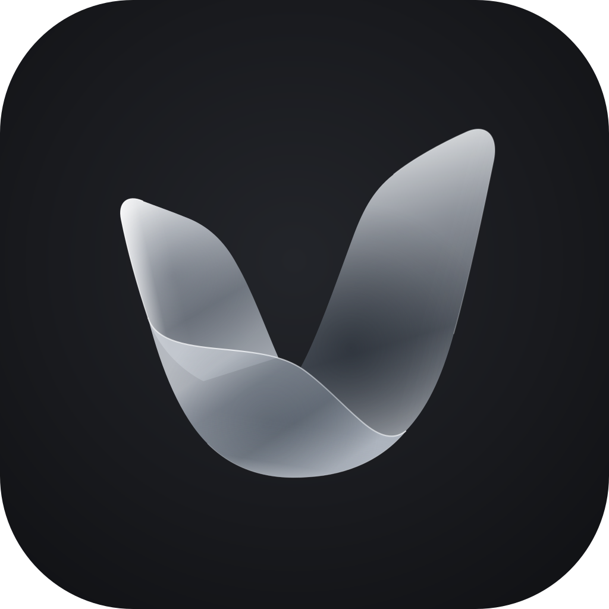
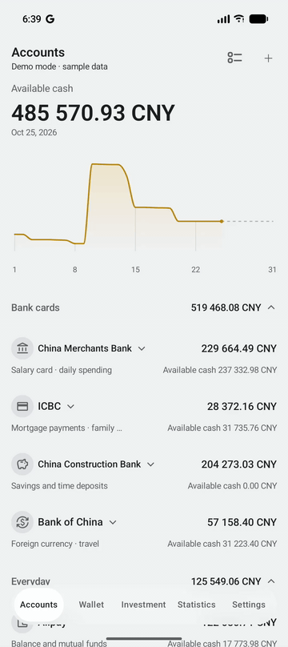
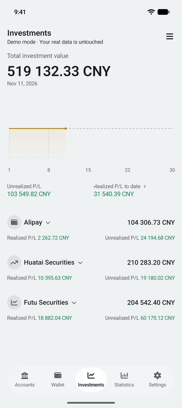
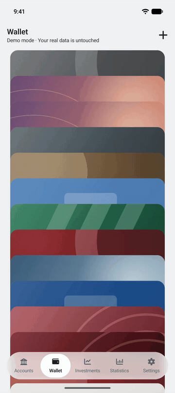

<p align="center">
  
</p>

<h1 align="center">Valnook</h1>

<p align="center">A personal finance app for Android that keeps your records on your device.</p>

<p align="center">
  <a href="https://github.com/LuoIsHere/Valnook/releases"></a>
  <a href="LICENSE"></a>
  
</p>

<p align="center">English · <a href="docs/README_CN.md">简体中文</a></p>

Valnook records what you own and what you owe: bank accounts, credit cards, term deposits and investments, in any number of currencies. It needs no sign-up, and the developer runs no server. Your records stay on the device, and the app goes online only for features you turn on: OneDrive backup and automatic exchange rates.

## Features

<table>
  <tr><th>Accounts</th><th>Investments</th><th>Wallet</th></tr>
  <tr>
    <td></td>
    <td></td>
    <td></td>
  </tr>
</table>

**Accounts and cash**
- Each main account, such as a bank or a broker, holds savings and credit sub-accounts in one or more currencies. Main accounts can be sorted into groups that fold and unfold.
- Each account page shows a three-month net assets trend. Balance changes are grouped by day with the balance after each change.
- Credit sub-accounts track their limit, statement day and due day.

**Investments**
- Record buys and sells with their fees, and dividends. Valnook works out the average cost, realized and unrealized profit, and the value of each holding.
- Each instrument has one page covering every account: its current price, holdings by account, trade history by month and a price trend.
- Sort instruments into asset classes, and see realized profit broken down by instrument. Prices are entered by hand.

**Term deposits**
- Record the principal, term and interest rate, optionally taking the principal from a sub-account, and settle a deposit when it matures.

**Exchange rates**
- Totals are converted to a base currency of your choice. Enter rates by hand, or turn on automatic rates from [Frankfurter](https://frankfurter.dev), which update once a day.
- Statistics value each past day at that day's rate. Currencies without a rate are left out of totals and marked, rather than counted at 1:1.

**Statistics**
- Daily and monthly trends for net assets, available cash and investment value.

**Wallet**
- Arrange cards in a stack with built-in faces or your own images, kept in a card face library.
- A card linked to a sub-account shows its balance and activity.
- Card-back details, such as the card number and CVV, are encrypted on the device.

**Web management**
- Pair a browser on the same local network with a QR code or a six-digit code to manage accounts, records and investments from a computer.

**Backup and export**
- Create local backup files, back up to OneDrive by hand or on a schedule, and export to Excel. Backups are read back and checked after they are written, wherever the storage location allows it.

**Interface**
- English and Simplified Chinese; light and dark themes, following the system by default. A demo mode lets you explore with sample data.

## Design principles

- **Local first.** Records are stored on the device. There is no Valnook account, and the developer runs no server.
- **Online only by choice.** The app connects to the internet only for OneDrive backup and automatic exchange rates, both off until you turn them on. Web management stays on your local network.
- **Card details stay on the device.** Card-back details are encrypted with a key held by Android Keystore. They are never included in backups, exports or web management.
- **Your data is portable.** Full backups are self-contained files in a [documented format](docs/DATABASE.md), and everything can be exported to Excel.
- **No ads and no tracking.** Valnook contains no advertising or analytics libraries, and your records are never used for advertising.

## Requirements

- Android 13 or later.

## Installation

1. Download the latest APK from the [Releases page](https://github.com/LuoIsHere/Valnook/releases).
2. Open it on your phone. If Android asks, allow your browser or file manager to install unknown apps.
3. Open Valnook and follow the setup.

**Upgrading:** install the new APK over the existing app. Your records are kept. Backups made by a newer version cannot be restored in an older one.

## Getting started

1. Choose a language and accept the privacy policy.
2. Choose a base currency. You can turn on automatic exchange rates here or later in Settings.
3. Add a main account with **+** on the Accounts page, together with its sub-accounts, their currencies and opening balances.
4. Record balance changes, trades and term deposits as they happen.
5. To look around first, turn on **Settings > Demo mode**. Demo data is temporary and separate from your records.

## Before you start

- Investment prices are entered by hand. Exchange rates are entered by hand unless you turn on automatic rates, which are provided by a third party for reference only. See the [privacy policy](docs/PRIVACY_POLICY_EN.md#4-automatic-exchange-rates) for what is sent.
- OneDrive is the only supported cloud backup. Google Drive backup [has been disabled](docs/GOOGLE_DRIVE_BACKUP.md).
- Backup files and Excel exports are not encrypted. Store them somewhere safe.
- Card-back details are never backed up. They are cleared by a restore and cannot be recovered after the app is uninstalled or the device is replaced.
- Web management uses an unencrypted connection. Use it only on trusted networks and devices.
- Valnook is a tool for recording and calculating, not investment advice. Check important figures yourself.

## Building from source

Requirements: Android Studio with JDK 17 or later and Android SDK Platform 37. The JDK bundled with Android Studio works.

```bash
./gradlew :app:assembleDebug
```

```bash
./gradlew testDebugUnitTest
```

The app is written in Kotlin with Jetpack Compose and Material 3. Room stores the data, Hilt provides dependency injection and Navigation 3 handles navigation. Web management is plain HTML, CSS and JavaScript served by a Ktor server inside the app. OneDrive sign-in is registered to the project's signing keys and is unavailable in builds signed with other keys.

<details>
<summary>Modules</summary>

| Module | Contents |
| --- | --- |
| `app` | Startup, navigation, dependency wiring and data sessions. |
| `core:domain` | Data models, financial rules and repository interfaces. |
| `core:data` | Storage, repositories, exchange rates, backup and restore, and the web server. |
| `core:designsystem` | Shared themes, icons and UI components. |
| `feature:*` | Accounts, cash, deposits, investments, wallet, statistics, settings, backup and web management screens. |

</details>

## Documentation

- [CHANGELOG.md](CHANGELOG.md): the main changes in each version.
- [docs/CHANGELOG.md](docs/CHANGELOG.md): the full list of changes in every version.
- [docs/DATABASE.md](docs/DATABASE.md): the database structure and the backup format.
- [docs/ONEDRIVE_BACKUP.md](docs/ONEDRIVE_BACKUP.md): how OneDrive backup works.
- [docs/PRIVACY_POLICY_EN.md](docs/PRIVACY_POLICY_EN.md): the privacy policy and disclaimer.
- [LICENSE](LICENSE): the MIT License.
- [THIRD_PARTY_NOTICES](THIRD_PARTY_NOTICES): third-party software and icons included in Valnook, with their licenses.

## License and disclaimer

Copyright © 2026 LuoIsHere

Valnook is released under the [MIT License](LICENSE) and is provided "as is", **without warranty of any kind**. To the fullest extent permitted by applicable law, the authors and copyright holders are not liable for any financial loss arising from the use of, or inability to use, this software. See the [privacy policy and disclaimer](docs/PRIVACY_POLICY_EN.md).

## Acknowledgements and trademarks

Valnook is built with [Jetpack Compose](https://developer.android.com/compose), [Room](https://developer.android.com/training/data-storage/room), [Hilt](https://dagger.dev/hilt/), [Ktor](https://ktor.io), the [Microsoft Authentication Library](https://github.com/AzureAD/microsoft-authentication-library-for-android) and [ZXing](https://github.com/zxing/zxing). Icons are from [Font Awesome Free](https://fontawesome.com) under CC BY 4.0, and automatic exchange rates come from [Frankfurter](https://frankfurter.dev). Full details and licenses are in [THIRD_PARTY_NOTICES](THIRD_PARTY_NOTICES).

Android is a trademark of Google LLC. Microsoft and OneDrive are trademarks of Microsoft Corporation. Valnook is an independent project and is not affiliated with or endorsed by Google, Microsoft or Frankfurter.

## A note from the author

I'm an embedded developer, and Valnook is my first Android app. Every finance app I tried felt a little off, and the things I wanted most, like a card wallet, investment summaries and cloud backup, were usually behind a paywall. So I built my own and made it open source. Keeping track of your own money shouldn't cost a subscription, or mean trusting software you can't look inside.

Valnook was built with Codex and Claude Code. AI wrote most of the code; the architecture, the approach and the trade-offs are my decisions. I use it every day. It's still early and surely rough in places, so if something feels off or breaks, please [open an issue](https://github.com/LuoIsHere/Valnook/issues).
