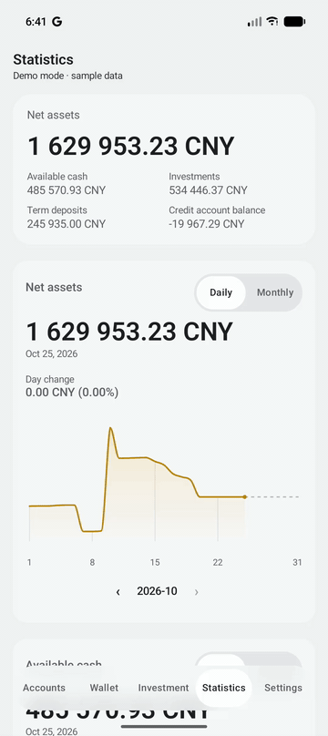

  

<h1 align="center">Valnook</h1>

An Android app for recording personal finances, with data stored on the device.

<strong>Version 0.0.17</strong> · <a href="LICENSE">MIT License</a>

English · <a href="docs/README_CN.md">简体中文</a>

Valnook records personal assets and liabilities across bank accounts, credit cards, term deposits and investments, in multiple currencies. It needs no account and no server. Data is stored on the device, with optional backup to OneDrive.

## Features

- **Accounts.** Each main account, such as a bank or a broker, holds savings and credit subaccounts in one or more currencies. Record balance changes, view balance trends for the past three months, and track credit limits and billing dates. Main accounts can be arranged in collapsible groups.
- **Term deposits.** Record the principal, term and interest rate, and settle a deposit at maturity.
- **Investments.** Record holdings and trades, with average cost, realized and unrealized profit, and a monthly value chart. Prices are entered manually.
- **Statistics.** View daily and monthly trends for net assets, available cash and investment value.
- **Wallet.** Arrange cards in a stack using built-in designs or imported images, kept in a card face library. A card linked to a subaccount shows its balance and the current month's activity. Card-back details, such as the card number and CVV, are encrypted and remain on the device.
- **Web management.** Pair a browser on the same local network to manage accounts and records from a computer.
- **Backup and export.** Create local backup files, back up to OneDrive manually or on a schedule, and export to Excel.

The app is available in English and Chinese, supports light and dark themes, and includes a demo mode with sample data.

<table>
  <tr><th>Accounts</th><th>Statistics</th><th>Wallet</th></tr>
  <tr>
    <td></td>
    <td></td>
    <td></td>
  </tr>
</table>

## Download

The latest build is available on the [Releases](https://github.com/LuoIsHere/Valnook/releases) page. Valnook requires Android 16 or later.

## Before you start

- Investment prices and exchange rates are entered manually and are not retrieved from the internet.
- OneDrive is the only supported cloud backup. Google Drive backup [has been disabled](docs/GOOGLE_DRIVE_BACKUP.md).
- Backup files and Excel exports are not encrypted and should be stored securely.
- Card-back details are never backed up. They are empty after a restore and cannot be recovered after the app is uninstalled or the device is replaced.
- The connection between web management and the phone is not encrypted. Use it only on trusted networks and devices.
- Valnook provides recording and calculation tools, not investment advice. Verify important figures independently.

See the [Privacy Policy](docs/PRIVACY_POLICY_EN.md) for details.

## For developers

The app is written in Kotlin with Jetpack Compose and Material 3. Room stores the data, Hilt provides dependency injection, and Navigation 3 handles navigation. Web management consists of bundled HTML, CSS and JavaScript served by a Ktor server inside the app. Card-back details are encrypted with AES-GCM using a key managed by Android Keystore.

A debug build requires no additional configuration: `./gradlew :app:assembleDebug`. OneDrive sign-in is registered to the project's signing keys and is unavailable in builds signed with other keys.

- [How OneDrive backup works](docs/ONEDRIVE_BACKUP.md)
- [Database structure](docs/DATABASE.md)
- [Full changelog](docs/CHANGELOG.md)

Modules

| Module | Contents |
| --- | --- |
| `app` | Startup, navigation, dependency wiring, and data sessions. |
| `core:domain` | Data models, financial rules, and repository interfaces. |
| `core:data` | Storage, repositories, backup and restore, and the web server. |
| `core:designsystem` | Shared themes and UI components. |
| `feature:*` | Accounts, cash, deposits, investments, wallet, statistics, settings, backup, and web management screens. |

## Disclaimer

Valnook is provided under the [MIT License](LICENSE), without warranty. To the fullest extent permitted by applicable law, the authors and copyright holders are not liable for financial loss arising from the use of or inability to use this software. See the [Privacy Policy and Disclaimer](docs/PRIVACY_POLICY_EN.md).

## A note from the author

I'm an embedded developer, and Valnook is my first Android app. Every finance app I tried felt a little off, and the things I wanted most, like a card wallet, investment summaries and cloud backup, were usually behind a paywall. So I built my own and made it open source. Keeping track of your own money shouldn't cost a subscription, or mean trusting software you can't look inside.

Valnook was built with Codex and Claude Code. AI wrote most of the code; the architecture, the approach and the trade-offs are my decisions. I use it every day. It's still early and surely rough in places, so if something feels off or breaks, please [open an issue](https://github.com/LuoIsHere/Valnook/issues).
