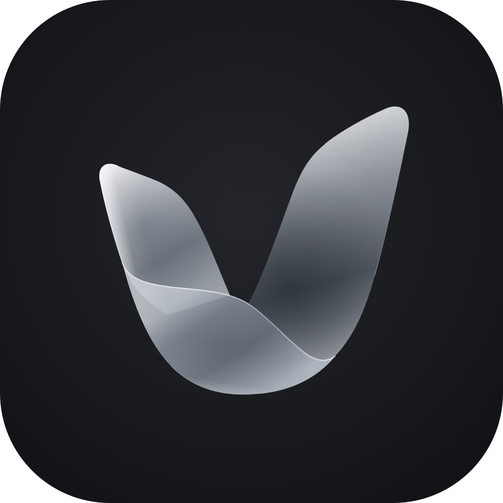
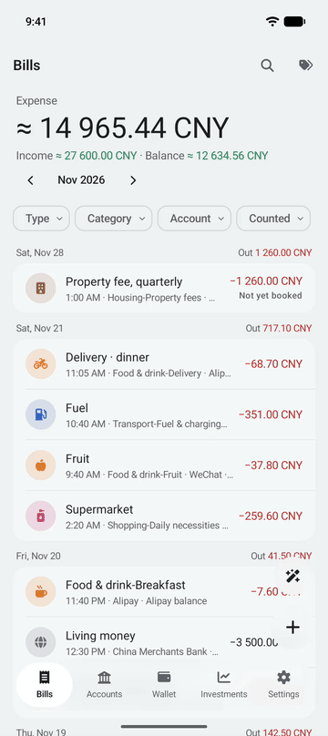
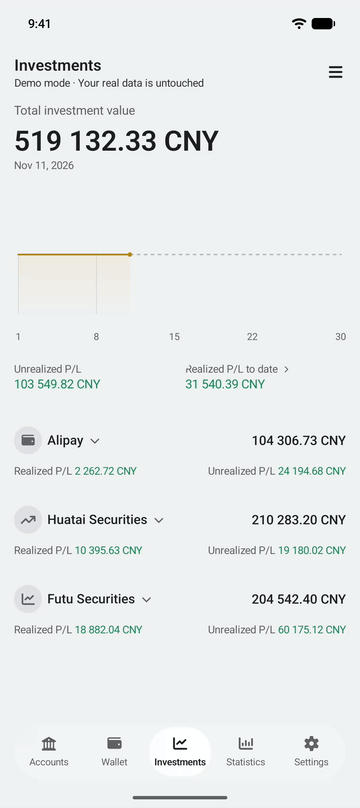
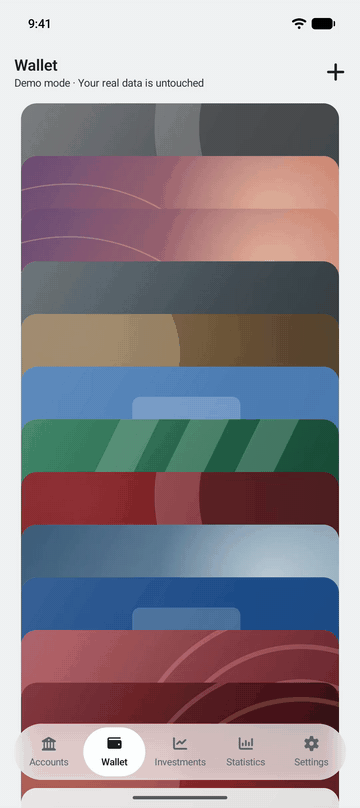

<p align="center">
  
</p>

<h1 align="center">Valnook</h1>

<p align="center">A personal finance app for Android that keeps your records on your phone.</p>

<p align="center">
  <a href="https://github.com/LuoIsHere/Valnook/releases"></a>
  <a href="LICENSE"></a>
  
  <a href="https://github.com/LuoIsHere/Valnook/actions/workflows/ci.yml"></a>
</p>

<p align="center">English · <a href="docs/README_CN.md">简体中文</a></p>

Valnook keeps track of what you own, what you owe and where your money goes: bank accounts, credit cards, term deposits, investments and everyday spending, in as many currencies as you need. There's no sign-up, and the developer runs no server. Everything stays on your phone, and the app only goes online for the features you switch on: OneDrive backup, automatic exchange rates and AI bookkeeping.

## Features

<table>
  <tr><th>AI bookkeeping</th><th>Investments</th><th>Wallet</th></tr>
  <tr>
    <td></td>
    <td></td>
    <td></td>
  </tr>
</table>

**Bills**
- Log expenses, income and transfers. There are 88 built-in categories to start with, and you can rename, hide, reorder or add your own.
- Add a discount, a note or up to 4 pictures to any bill. A bill doesn't have to belong to an account.
- Bills in another currency are converted at that day's rate, or at a rate you set for that bill. Transfers work across currencies and can include a fee.
- Refund an expense in full or in parts, or mark it as reimbursable and keep track of what you're still owed on the Reimbursements page.
- Quick bookkeeping: have the app open straight to a new bill, record from the share menu of other apps, or use the shortcuts on the app icon.

**AI bookkeeping** (optional, off by default)
- Bring your own AI: connect any OpenAI-compatible service with your own API key. Valnook doesn't provide or relay an AI service. The built-in quick start walks you through the settings, using DeepSeek as an example.
- Type something like "taxi 32 yesterday", share a message, or send a screenshot, and the AI drafts the bill for you. Nothing is saved until you confirm, and you can still edit or undo a bill afterwards.
- Ask about your spending, such as how much you spent on dining last month. The AI looks up the numbers on your phone and shows you which lookups it ran.
- Requests go straight from your phone to the service you chose. Your API key is encrypted on the device, and balances and account numbers are never sent. The [privacy policy](docs/PRIVACY_POLICY_EN.md#5-ai-features) lists exactly what is sent.

**Accounts and cash**
- Each main account, such as a bank or a broker, holds savings and credit sub-accounts in one or more currencies. Main accounts can be sorted into groups, and groups fold away when you don't need them.
- Account pages show a three-month net assets trend, with balance changes grouped by day and the balance after each one.
- Credit cards keep their limit, statement day and due day. View them by billing cycle to see this cycle's spending, what the last statement came to and how much is left to pay.

**Investments**
- Record buys, sells (with fees) and dividends. Valnook works out the average cost, realized and unrealized profit, and the value of each holding.
- Every instrument gets one page across all your accounts: current price, holdings by account, trade history by month and a price trend.
- Group instruments into asset classes and see realized profit by instrument. Prices are entered by hand.

**Term deposits**
- Record the principal, term and interest rate, optionally funding the deposit from a sub-account, and settle it when it matures.

**Exchange rates**
- Totals are shown in a base currency of your choice. Enter rates yourself, or turn on automatic rates from [Frankfurter](https://frankfurter.dev), updated once a day.
- Statistics value each day at that day's rate. Currencies without a rate are left out of totals and flagged, instead of being counted at 1:1.

**Statistics**
- Daily and monthly trends for net assets, available cash and investments, plus a breakdown of your assets by account, asset type and currency.
- Monthly spending and income, with a category ring, daily bars and the bills behind each category.

**Wallet**
- Stack your cards with built-in designs or your own images, saved in a card face library.
- Link a card to a sub-account to see its balance and activity.
- Card-back details, such as the card number and CVV, are encrypted on the device.

**Web management**
- Pair a browser on your local network by QR code or six-digit code, then manage accounts, records and investments from your computer, and browse bills and spending statistics.

**Backup and export**
- Save local backup files, back up to OneDrive by hand or on a schedule, and export to Excel. Wherever the storage allows, each backup is read back and checked after it is written.
- Bill pictures are backed up to OneDrive and downloaded again when needed. Once they're in OneDrive, you can clear them from your phone by hand or automatically.

**Interface**
- English and Simplified Chinese, light and dark themes that follow the system by default, and a demo mode with sample data for trying things out.

## Design principles

- **Local first.** Your records live on your phone. There's no Valnook account and no Valnook server.
- **Online only when you choose.** Only OneDrive backup, automatic exchange rates and AI bookkeeping use the internet, and all three stay off until you turn them on. Web management stays on your local network.
- **Card details stay on your phone.** Card-back details are encrypted with a key held by Android Keystore, and never go into backups, exports or web management.
- **Your data is yours to take.** Full backups are self-contained files in a [documented format](docs/DATABASE.md), and everything can be exported to Excel.
- **No ads, no tracking.** Valnook includes no advertising or analytics libraries, and your records are never used for ads.

## Requirements

- Android 13 or later.

## Installation

1. Download the latest APK from the [Releases page](https://github.com/LuoIsHere/Valnook/releases).
2. Open it on your phone. If Android asks, allow your browser or file manager to install unknown apps.
3. Open Valnook and follow the setup steps.

**Upgrading:** install the new APK over the old one, and your records are kept. Backups made by a newer version can't be restored in an older one.

## Getting started

1. Pick a language and accept the privacy policy.
2. Pick a base currency. You can turn on automatic exchange rates here, or later in Settings.
3. On the Accounts page, tap **+** to add a main account with its sub-accounts, their currencies and opening balances.
4. Tap **+** on the main pages to record bills, and add balance changes, trades and term deposits as they happen. To record bills by chatting, set up **Settings > AI**.
5. Want to look around first? Turn on **Settings > Demo mode**. Demo data is temporary and kept apart from your own records.

## Before you start

- Investment prices are entered by hand. So are exchange rates, unless you turn on automatic rates, which come from a third party and are for reference only. See the [privacy policy](docs/PRIVACY_POLICY_EN.md#4-automatic-exchange-rates) for what is sent.
- AI drafts can be wrong, so check each one before you confirm it. When you use AI features, what you type or share goes to the service you chose, under its own terms and pricing.
- OneDrive is the only supported cloud backup. Google Drive backup [has been disabled](docs/GOOGLE_DRIVE_BACKUP.md).
- Backup files and Excel exports aren't encrypted, so keep them somewhere safe. Local backups don't include bill pictures; only OneDrive backups do.
- Card-back details are never backed up. A restore clears them, and they can't be recovered after you uninstall the app or switch phones.
- Web management uses an unencrypted connection, so only use it on networks and devices you trust.
- Valnook helps you record and calculate; it doesn't give investment advice. Double-check the figures that matter.

## Building from source

You'll need Android Studio with JDK 17 or later and Android SDK Platform 37. The JDK bundled with Android Studio is fine.

```bash
./gradlew :app:assembleDebug
```

```bash
./gradlew quickCheck
```

`quickCheck` builds every module, runs all unit tests, compiles the device tests and checks the web management scripts. CI runs the same command on every push.

The app is written in Kotlin with Jetpack Compose and Material 3. Room stores the data, Hilt handles dependency injection and Navigation 3 handles navigation. Web management is plain HTML, CSS and JavaScript, served by a Ktor server inside the app. OneDrive sign-in is tied to the project's signing keys, so it doesn't work in builds signed with other keys.

<details>
<summary>Modules</summary>

| Module | Contents |
| --- | --- |
| `app` | Startup, navigation, dependency wiring and data sessions. |
| `core:domain` | Data models, financial rules and repository interfaces. |
| `core:data` | Storage, repositories, exchange rates, backup and restore, and the web server. |
| `core:designsystem` | Shared themes, icons and UI components. |
| `feature:*` | Accounts, cash, deposits, investments, bills, AI, wallet, statistics, settings, backup and web management screens. |

</details>

## Documentation

- [CHANGELOG.md](CHANGELOG.md): the main changes in each version.
- [docs/CHANGELOG.md](docs/CHANGELOG.md): the full list of changes in every version.
- [docs/DATABASE.md](docs/DATABASE.md): the database structure and the backup format.
- [docs/ONEDRIVE_BACKUP.md](docs/ONEDRIVE_BACKUP.md): how OneDrive backup works.
- [docs/PRIVACY_POLICY_EN.md](docs/PRIVACY_POLICY_EN.md): the privacy policy and disclaimer.
- [LICENSE](LICENSE): the MIT License.
- [THIRD_PARTY_NOTICES](THIRD_PARTY_NOTICES): the third-party software and icons in Valnook, with their licenses.

## License and disclaimer

Copyright © 2026 LuoIsHere

Valnook's source code is released under the [MIT License](LICENSE). The license doesn't extend to the Valnook name or logo: forks and modified builds are welcome to use the code, but please give them their own name and logo, and don't present them as the official app.

Valnook is provided "as is", **without warranty of any kind**. To the fullest extent permitted by applicable law, the authors and copyright holders are not liable for any financial loss arising from the use of, or inability to use, this software. See the [privacy policy and disclaimer](docs/PRIVACY_POLICY_EN.md).

## Acknowledgements and trademarks

Valnook is built with [Jetpack Compose](https://developer.android.com/compose), [Room](https://developer.android.com/training/data-storage/room), [Hilt](https://dagger.dev/hilt/), [Ktor](https://ktor.io), the [Microsoft Authentication Library](https://github.com/AzureAD/microsoft-authentication-library-for-android) and [ZXing](https://github.com/zxing/zxing). Icons come from [Font Awesome Free](https://fontawesome.com) under CC BY 4.0, and automatic exchange rates come from [Frankfurter](https://frankfurter.dev). Full details and licenses are in [THIRD_PARTY_NOTICES](THIRD_PARTY_NOTICES).

Android is a trademark of Google LLC. Microsoft and OneDrive are trademarks of Microsoft Corporation. DeepSeek and OpenAI are trademarks of their respective owners. DeepSeek is mentioned only as an example in the AI setup guide, not as a recommendation. Valnook is an independent project and is not affiliated with or endorsed by Google, Microsoft, Frankfurter, DeepSeek or OpenAI.

## A note from the author

I'm an embedded developer, and Valnook is my first Android app. Every finance app I tried felt a little off, and the things I wanted most, like a card wallet, investment summaries and cloud backup, were usually behind a paywall. So I built my own and made it open source. Keeping track of your own money shouldn't cost a subscription, or mean trusting software you can't look inside.

Valnook was built with Codex and Claude Code. AI wrote most of the code; the architecture, the approach and the trade-offs are my decisions. I use it every day. It's still early and surely rough in places, so if something feels off or breaks, please [open an issue](https://github.com/LuoIsHere/Valnook/issues).
