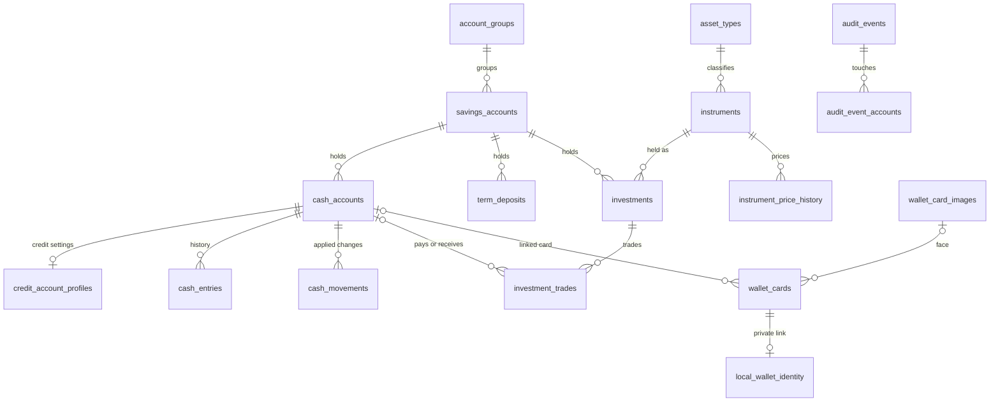

# Valnook Database Structure

This document describes how Valnook stores data on the device. It covers database schema 21, used by Valnook 0.0.17.

The database is the app's internal storage, not a stable interface. Tables and columns can change in any version, and the app migrates existing data automatically when it is updated. The exported Room schema, [`21.json`](../core/data/schemas/dev.valnook.data.database.ValnookDatabase/21.json), is the authoritative definition; this document explains what the tables mean.

## Storage overview

- **Main database:** `valnook.db` in the app's private storage, an SQLite database managed by Room in write-ahead logging mode.
- **Demo data:** demo mode copies a bundled database into a separate temporary file and never touches `valnook.db`. The copy is removed when demo mode ends.
- **Outside the database:**
  - Private card-back details (card number, cardholder name, expiry date, CVVs, and back and edge colors) are encrypted with AES-GCM using a key held in Android Keystore, and stored in the app's no-backup directory. The database only keeps a random link to each file in `local_wallet_identity`.
  - The theme and the first-launch setup state are kept in Android shared preferences.
  - Microsoft sign-in tokens are kept by Microsoft's sign-in library (MSAL) in its own cache.
  - Web management sessions exist only in memory.
- **Protection:** the database itself is not encrypted. It relies on Android's app isolation and device security, and Android system backup and device transfer are turned off for it. See the [Privacy Policy](PRIVACY_POLICY_EN.md).

## Conventions

| Pattern | Meaning |
| --- | --- |
| `*_minor` | Money as a whole number of the currency's smallest unit. The number of decimals comes from `currencies.fraction_digits` (2 for `CNY`, 0 for `JPY`). |
| `*_e8`, `*_e5` | Fixed-point numbers multiplied by 10^8 or 10^5: quantities and trade prices use `_e8`, current and historical prices use `_e5`, and deposit rates use `annual_rate_percent_e8`. |
| Decimal strings | Some exact values are stored as text, such as exchange rates, remaining costs, and statistics values. |
| `*_ms`, `*_utc_ms` | Milliseconds since the Unix epoch, in UTC. |
| `*_epoch_day` | A local calendar date as days since 1970-01-01. |
| `revision` | Optimistic concurrency. A change must name the revision it read; a stale revision is rejected. |
| `is_deleted` | Soft delete. The row stays so that history remains consistent. |
| `operation_id` | The receipt of the write that created the row; see `operations`. |
| Booleans | Stored as `INTEGER` 0 or 1. |
| Single-row tables | `app_settings`, `statistics_state`, `audit_metadata`, `local_maintenance_state`, and `cloud_backup_state` always have one row with `id` 1. |

## Relationships

The diagram shows the main links. Every money and instrument table also refers to `currencies`, and most rows that come from a write also refer to `operations`; these links are left out for readability.

Delete rules:

- Most foreign keys use `RESTRICT`, so a row cannot be deleted while other rows still point to it. The app deletes dependent rows first, inside one transaction.
- `wallet_cards.bound_cash_account_id` uses `SET NULL`: deleting a subaccount keeps the card and marks its link as lost.
- `local_wallet_identity` and `audit_event_accounts` use `CASCADE`: they disappear with their card or event.
- `savings_accounts.group_id` is not a declared foreign key. Accounts whose group is missing sort with the default group.

## Tables

Types are SQLite type affinities. "Null" marks columns that may be empty. "PK" marks the primary key.

### Accounts

#### `account_groups`

Named groups of main accounts on the Accounts page. Row `1` is the default group; it has an empty name and is labelled in the app language.

| Column | Type | Null | Description |
| --- | --- | --- | --- |
| `id` (PK) | INTEGER |  | Group ID. `1` is the default group. |
| `name` | TEXT |  | Group name. Empty for the default group. |
| `display_order` | INTEGER |  | Position of the group on the Accounts page. |
| `collapsed` | INTEGER |  | Boolean. Whether the group is folded. |
| `created_at_ms` | INTEGER |  | When the row was created (UTC ms). |
| `updated_at_ms` | INTEGER |  | When the row was last changed (UTC ms). |

#### `savings_accounts`

Main accounts, such as a bank or a broker. Each holds subaccounts, term deposits and holdings.

| Column | Type | Null | Description |
| --- | --- | --- | --- |
| `id` (PK) | INTEGER |  | Account ID. |
| `name` | TEXT |  | Account name. |
| `note` | TEXT |  | Free-text note. |
| `created_at_ms` | INTEGER |  | When the row was created (UTC ms). |
| `updated_at_ms` | INTEGER |  | When the row was last changed (UTC ms). |
| `revision` | INTEGER |  | Revision for optimistic concurrency; increases on every change. |
| `display_order` | INTEGER |  | Global order of accounts: group order first, then position inside the group. |
| `icon_type` | TEXT |  | `SYMBOL` for a built-in Material Symbol, `IMAGE` for an imported picture. |
| `icon_value` | TEXT |  | Symbol name, or the ID of a row in `account_icon_images`. |
| `show_deposit_summary` | INTEGER |  | Boolean. Show the term-deposit summary on the account. |
| `show_investment_summary` | INTEGER |  | Boolean. Show the investment summary on the account. |
| `group_id` | INTEGER |  | The account's group (`account_groups.id`). Not a declared foreign key; accounts whose group is missing sort with the default group. |

#### `account_icon_images`

Imported account icon pictures, stored once and shared by content.

| Column | Type | Null | Description |
| --- | --- | --- | --- |
| `id` (PK) | TEXT |  | SHA-256 of the image bytes. |
| `data` | BLOB |  | Cropped, re-encoded image. |

#### `cash_accounts`

Subaccounts: one balance in one currency inside a main account. Savings and credit subaccounts share this table; credit ones also have a row in `credit_account_profiles`.

| Column | Type | Null | Description |
| --- | --- | --- | --- |
| `savings_account_id` | INTEGER |  | Main account (`savings_accounts.id`). |
| `currency_code` | TEXT |  | Currency of the balance. |
| `balance_minor` | INTEGER |  | Current balance in minor units. Negative values are allowed, for example on credit cards. |
| `revision` | INTEGER |  | Revision for optimistic concurrency; increases on every change. |
| `updated_at_ms` | INTEGER |  | When the row was last changed (UTC ms). |
| `id` (PK) | INTEGER |  | Subaccount ID. |
| `name` | TEXT |  | Subaccount name. |
| `note` | TEXT |  | Free-text note. |
| `currency_locked` | INTEGER |  | Boolean. The currency can no longer be changed. |
| `created_at_ms` | INTEGER |  | When the row was created (UTC ms). |
| `display_order` | INTEGER |  | Position inside the main account. |
| `include_in_available_cash` | INTEGER |  | Boolean. Count this balance in available cash. Total assets always include it. |
| `show_on_accounts_page` | INTEGER |  | Boolean. Show the subaccount on the Accounts page. |

Keys: `savings_account_id` → `savings_accounts` (on delete: RESTRICT). `currency_code` → `currencies` (on delete: RESTRICT).

#### `credit_account_profiles`

Credit-card settings for credit subaccounts.

| Column | Type | Null | Description |
| --- | --- | --- | --- |
| `account_id` (PK) | INTEGER |  | The credit subaccount (`cash_accounts.id`). |
| `credit_limit_minor` | INTEGER | yes | Own credit limit in minor units. Empty when the limit is shared from another card. |
| `statement_day` | INTEGER |  | Day of the month the statement is issued. |
| `due_rule_type` | TEXT |  | `FIXED_DAY_OF_MONTH` or `AFTER_STATEMENT_DAYS`. |
| `due_rule_value` | INTEGER |  | The due day of the month, or the number of days after the statement. |
| `limit_source_account_id` | INTEGER | yes | Subaccount whose limit this card shares, if any. |

Keys: `account_id` → `cash_accounts` (on delete: RESTRICT). `limit_source_account_id` → `cash_accounts` (on delete: RESTRICT).

### Term deposits

#### `term_deposits`

Term deposits held in a main account.

| Column | Type | Null | Description |
| --- | --- | --- | --- |
| `id` (PK) | INTEGER |  | Deposit ID. |
| `savings_account_id` | INTEGER |  | Main account. |
| `currency_code` | TEXT |  | Deposit currency. |
| `principal_minor` | INTEGER |  | Principal in minor units. |
| `annual_rate_percent_e8` | INTEGER |  | Annual rate in percent, times 10^8 (3% is `300000000`). |
| `start_epoch_day` | INTEGER |  | Start date (local date as epoch day). |
| `end_epoch_day` | INTEGER |  | Maturity date (local date as epoch day). |
| `interest_rule` | TEXT |  | Interest convention. Currently `ACT_365F_SIMPLE`: simple interest on actual days over a fixed 365-day year. |
| `calculation_version` | INTEGER |  | Version of the interest calculation that produced `expected_interest_minor`. |
| `rounding_mode` | TEXT |  | Rounding used for interest, such as `HALF_UP`. |
| `expected_interest_minor` | INTEGER |  | Interest at maturity in minor units. |
| `status` | TEXT |  | `OPEN` or `CLOSED`. |
| `open_cash_linked` | INTEGER |  | Boolean. Opening the deposit took the principal from a subaccount. |
| `close_cash_linked` | INTEGER | yes | Boolean. Closing paid principal and interest into a subaccount. Empty while open. |
| `open_cash_account_id` | INTEGER | yes | Subaccount debited on opening, if linked. |
| `close_cash_account_id` | INTEGER | yes | Subaccount credited on closing, if linked. |
| `open_operation_id` | TEXT |  | Receipt of the opening operation. |
| `close_operation_id` | TEXT | yes | Receipt of the closing operation. |
| `closed_at_ms` | INTEGER | yes | When the deposit was closed (UTC ms). |
| `created_at_ms` | INTEGER |  | When the row was created (UTC ms). |
| `updated_at_ms` | INTEGER |  | When the row was last changed (UTC ms). |
| `revision` | INTEGER |  | Revision for optimistic concurrency; increases on every change. |

Keys: Unique: (`open_operation_id`). Unique: (`close_operation_id`). `savings_account_id` → `savings_accounts` (on delete: RESTRICT). `currency_code` → `currencies` (on delete: RESTRICT). `open_operation_id` → `operations` (on delete: RESTRICT). `close_operation_id` → `operations` (on delete: RESTRICT). `open_cash_account_id` → `cash_accounts` (on delete: RESTRICT). `close_cash_account_id` → `cash_accounts` (on delete: RESTRICT).

### Investments

#### `asset_types`

User-defined asset types, such as stocks or funds, used to group instruments.

| Column | Type | Null | Description |
| --- | --- | --- | --- |
| `id` (PK) | INTEGER |  | Type ID. |
| `name` | TEXT |  | Type name. |
| `normalized_name` | TEXT |  | Lower-cased name; unique, so two types cannot differ only by case. |
| `created_at_ms` | INTEGER |  | When the row was created (UTC ms). |
| `updated_at_ms` | INTEGER |  | When the row was last changed (UTC ms). |

Keys: Unique: (`normalized_name`).

#### `instruments`

Investment instruments and their current price.

| Column | Type | Null | Description |
| --- | --- | --- | --- |
| `id` (PK) | INTEGER |  | Instrument ID. |
| `asset_type_id` | INTEGER |  | Asset type. |
| `name` | TEXT |  | Instrument name. |
| `symbol` | TEXT |  | Ticker or code. |
| `currency_code` | TEXT |  | Trading currency. |
| `current_price_e5` | INTEGER |  | Current price times 10^5. |
| `currency_locked` | INTEGER |  | Boolean. Set after the first trade; the currency can no longer change. |
| `revision` | INTEGER |  | Revision for optimistic concurrency; increases on every change. |
| `symbol_locked` | INTEGER |  | Boolean. Set after the first trade; the symbol can no longer change. |
| `price_updated_at_ms` | INTEGER |  | When the current price was last set (UTC ms). |
| `created_at_ms` | INTEGER |  | When the row was created (UTC ms). |
| `updated_at_ms` | INTEGER |  | When the row was last changed (UTC ms). |

Keys: `asset_type_id` → `asset_types` (on delete: RESTRICT). `currency_code` → `currencies` (on delete: RESTRICT).

#### `investments`

Holdings: one instrument in one main account. Quantities and costs are rebuilt from the trades.

| Column | Type | Null | Description |
| --- | --- | --- | --- |
| `id` (PK) | INTEGER |  | Holding ID. |
| `savings_account_id` | INTEGER |  | Main account. |
| `instrument_id` | INTEGER |  | Instrument. |
| `opening_quantity_e8` | INTEGER |  | Legacy opening quantity. Unused since schema 8, which turned opening balances into trades. |
| `holding_quantity_e8` | INTEGER |  | Quantity held now, times 10^8. |
| `revision` | INTEGER |  | Revision for optimistic concurrency; increases on every change. |
| `created_at_ms` | INTEGER |  | When the row was created (UTC ms). |
| `updated_at_ms` | INTEGER |  | When the row was last changed (UTC ms). |
| `opening_cost_price_e8` | INTEGER | yes | Legacy opening cost price. Unused since schema 8. |
| `opening_at_ms` | INTEGER |  | Legacy opening time. Unused since schema 8. |
| `remaining_cost` | TEXT | yes | Cost of the quantity held, as a decimal string in the instrument currency. |
| `realized_profit` | TEXT | yes | Realized profit or loss so far, as a decimal string. |
| `chronology_valid` | INTEGER |  | Boolean. False when the trades cannot be replayed in date order, for example a sale before the purchase. |
| `algorithm_version` | INTEGER |  | Version of the cost rule used for `remaining_cost` and `realized_profit`. |
| `position_state` | TEXT |  | `PENDING` (no trades yet), `HOLDING`, or `CLOSED` (traded, nothing held). |
| `last_activity_at_ms` | INTEGER |  | Time of the latest trade, used for ordering (UTC ms). |

Keys: Unique: (`savings_account_id`, `instrument_id`). `savings_account_id` → `savings_accounts` (on delete: RESTRICT). `instrument_id` → `instruments` (on delete: RESTRICT).

#### `investment_trades`

Buy and sell trades of a holding.

| Column | Type | Null | Description |
| --- | --- | --- | --- |
| `id` (PK) | INTEGER |  | Trade ID. |
| `investment_id` | INTEGER |  | Holding. |
| `operation_id` | TEXT |  | Receipt of the operation that created the trade. |
| `direction` | TEXT |  | `BUY` or `SELL`. |
| `quantity_e8` | INTEGER |  | Quantity times 10^8. |
| `execution_price_e8` | INTEGER |  | Execution price times 10^8. |
| `amount_minor` | INTEGER |  | Trade amount, quantity times price rounded to the currency, in minor units. Excludes the fee. |
| `currency_code` | TEXT |  | Trade currency (the instrument currency). |
| `cash_linked` | INTEGER |  | Boolean. The trade moved money in a subaccount. |
| `cash_account_id` | INTEGER | yes | Subaccount charged or credited, if linked. |
| `occurred_at_ms` | INTEGER |  | Trade time (UTC ms). |
| `created_at_ms` | INTEGER |  | When the row was created (UTC ms). |
| `revision` | INTEGER |  | Revision for optimistic concurrency; increases on every change. |
| `is_deleted` | INTEGER |  | Boolean. Soft delete: the row is kept for history but no longer counts. |
| `updated_at_ms` | INTEGER |  | When the row was last changed (UTC ms). |
| `fee_minor` | INTEGER |  | Fee in minor units. A buy costs amount plus fee; a sale returns amount minus fee. |

Keys: Unique: (`operation_id`). `investment_id` → `investments` (on delete: RESTRICT). `operation_id` → `operations` (on delete: RESTRICT). `currency_code` → `currencies` (on delete: RESTRICT). `cash_account_id` → `cash_accounts` (on delete: RESTRICT).

#### `instrument_price_history`

Prices of an instrument over time, written whenever the current price is set.

| Column | Type | Null | Description |
| --- | --- | --- | --- |
| `id` (PK) | INTEGER |  | Price ID. |
| `instrument_id` | INTEGER |  | Instrument. |
| `price_e5` | INTEGER |  | Price times 10^5. |
| `currency_code` | TEXT |  | Currency. |
| `effective_at_ms` | INTEGER |  | When the price applies from (UTC ms). |
| `created_at_ms` | INTEGER |  | When the row was created (UTC ms). |
| `updated_at_ms` | INTEGER |  | When the row was last changed (UTC ms). |
| `revision` | INTEGER |  | Revision for optimistic concurrency; increases on every change. |
| `is_deleted` | INTEGER |  | Boolean. Soft delete: the row is kept for history but no longer counts. |

Keys: `instrument_id` → `instruments` (on delete: RESTRICT). `currency_code` → `currencies` (on delete: RESTRICT).

### Balance history and operation receipts

#### `operations`

Receipts of write operations. Each write carries a random operation ID; repeating it with the same request returns the first result instead of applying it twice.

| Column | Type | Null | Description |
| --- | --- | --- | --- |
| `operation_id` (PK) | TEXT |  | Operation ID chosen by the caller. |
| `kind` | TEXT |  | Operation kind, such as `CASH_SET`, `TRADE_EDIT` or `TERM_OPEN`. |
| `request_fingerprint` | TEXT |  | Digest of the request. Reusing an ID with a different request is rejected. |
| `result_kind` | TEXT | yes | Kind of record the operation produced. |
| `result_id` | INTEGER | yes | ID of that record. |
| `created_at_ms` | INTEGER |  | When the row was created (UTC ms). |

#### `cash_movements`

Balance changes as they were applied, with the balance before and after. Together with `cash_entries` it explains every balance.

| Column | Type | Null | Description |
| --- | --- | --- | --- |
| `id` (PK) | INTEGER |  | Movement ID. |
| `operation_id` | TEXT |  | Receipt of the operation. |
| `savings_account_id` | INTEGER |  | Main account. |
| `currency_code` | TEXT |  | Currency. |
| `cash_account_id` | INTEGER |  | Subaccount. |
| `reason` | TEXT |  | What caused the change, such as `CASH_SET`, `BUY`, `SELL`, `TERM_OPEN` or `TERM_CLOSE`. |
| `delta_minor` | INTEGER |  | Change in minor units. |
| `balance_before_minor` | INTEGER |  | Balance before. |
| `balance_after_minor` | INTEGER |  | Balance after. |
| `created_at_ms` | INTEGER |  | When the change was applied (UTC ms). |

Keys: Unique: (`operation_id`, `cash_account_id`). `operation_id` → `operations` (on delete: RESTRICT). `cash_account_id` → `cash_accounts` (on delete: RESTRICT).

#### `cash_entries`

The records shown in a subaccount's history, dated by when they happened. Each points to its source.

| Column | Type | Null | Description |
| --- | --- | --- | --- |
| `id` (PK) | INTEGER |  | Record ID. |
| `original_operation_id` | TEXT |  | Receipt of the operation that created the record. |
| `savings_account_id` | INTEGER |  | Main account. |
| `currency_code` | TEXT |  | Currency. |
| `cash_account_id` | INTEGER |  | Subaccount. |
| `source_kind` | TEXT |  | `CASH_SET` (balance adjustment), `TRADE`, `TERM_OPEN` or `TERM_CLOSE`. |
| `source_id` | INTEGER | yes | ID of the trade or deposit behind the record. Empty for balance adjustments. |
| `delta_minor` | INTEGER |  | Change in minor units. |
| `occurred_at_ms` | INTEGER |  | When it happened (UTC ms). |
| `note` | TEXT |  | Note. |
| `revision` | INTEGER |  | Revision for optimistic concurrency; increases on every change. |
| `is_deleted` | INTEGER |  | Boolean. Soft delete: the row is kept for history but no longer counts. |
| `created_at_ms` | INTEGER |  | When the row was created (UTC ms). |
| `updated_at_ms` | INTEGER |  | When the row was last changed (UTC ms). |

Keys: Unique: (`original_operation_id`, `cash_account_id`). Unique: (`source_kind`, `source_id`). `cash_account_id` → `cash_accounts` (on delete: RESTRICT). `original_operation_id` → `operations` (on delete: RESTRICT).

### Wallet

#### `wallet_cards`

Wallet cards. Card backs are not stored here; see Data outside the database.

| Column | Type | Null | Description |
| --- | --- | --- | --- |
| `id` (PK) | INTEGER |  | Card ID. |
| `name` | TEXT |  | Card name. |
| `image_key` | TEXT | yes | Face picture (`wallet_card_images.id`). Empty for a built-in design. |
| `bound_cash_account_id` | INTEGER | yes | Linked subaccount, if any. Cleared when the subaccount is deleted. |
| `display_order` | INTEGER |  | Position in the wallet. |
| `created_at_ms` | INTEGER |  | When the row was created (UTC ms). |
| `updated_at_ms` | INTEGER |  | When the row was last changed (UTC ms). |
| `revision` | INTEGER |  | Revision for optimistic concurrency; increases on every change. |
| `binding_lost` | INTEGER |  | Boolean. The linked subaccount was deleted. |
| `face_style` | TEXT | yes | Built-in design as `1\|background\|pattern\|base\|secondary\|accent`, with colors in hexadecimal ARGB. Empty when a picture is used. |

Keys: `image_key` → `wallet_card_images` (on delete: RESTRICT). `bound_cash_account_id` → `cash_accounts` (on delete: SET NULL).

#### `wallet_card_images`

The card face library. A picture can be used by several cards and stays after no card uses it.

| Column | Type | Null | Description |
| --- | --- | --- | --- |
| `id` (PK) | TEXT |  | SHA-256 of the image bytes. |
| `data` | BLOB |  | WebP image, re-encoded on the device. |
| `width` | INTEGER |  | Width in pixels. |
| `height` | INTEGER |  | Height in pixels. |
| `tint` | INTEGER |  | Average color of the image (ARGB). |
| `label` | TEXT |  | Name shown in the library. |
| `added_at_ms` | INTEGER |  | When the face was added (UTC ms). |

#### `local_wallet_identity`

Links a card to its encrypted card-back file with a random token. Holds no private values.

| Column | Type | Null | Description |
| --- | --- | --- | --- |
| `card_id` (PK) | INTEGER |  | Card. Deleting the card deletes the link. |
| `token` | TEXT |  | Random token naming the encrypted file. |

Keys: Unique: (`token`). `card_id` → `wallet_cards` (on delete: CASCADE).

### Settings and currencies

#### `currencies`

Supported currencies, seeded when the database is created.

| Column | Type | Null | Description |
| --- | --- | --- | --- |
| `code` (PK) | TEXT |  | ISO 4217 code, such as `CNY`. |
| `fraction_digits` | INTEGER |  | Decimal places used for `*_minor` amounts in this currency. |

#### `app_settings`

A single row (`id` 1) of app settings.

| Column | Type | Null | Description |
| --- | --- | --- | --- |
| `id` (PK) | INTEGER |  | Always `1`. |
| `base_currency` | TEXT | yes | Currency totals are converted into. Empty until set. |
| `revision` | INTEGER |  | Revision for optimistic concurrency; increases on every change. |
| `language` | TEXT |  | `SYSTEM`, `ZH_HANS` or `ENGLISH`. |
| `gain_loss_scheme` | TEXT |  | `GREEN_GAIN` or `RED_GAIN`. |
| `navigation_order` | TEXT |  | Comma-separated order of `ACCOUNTS`, `WALLET`, `INVESTMENTS`, `STATISTICS`, `SETTINGS`. |
| `navigation_visible` | TEXT |  | Comma-separated destinations shown in the navigation bar. |

Keys: `base_currency` → `currencies` (on delete: RESTRICT).

#### `fx_rates`

Exchange rates entered by the user.

| Column | Type | Null | Description |
| --- | --- | --- | --- |
| `source_currency` (PK) | TEXT |  | Currency converted from. |
| `target_currency` (PK) | TEXT |  | Currency converted to. |
| `rate` | TEXT |  | Decimal string: one unit of the source currency equals `rate` units of the target currency. |
| `updated_at_ms` | INTEGER |  | When the row was last changed (UTC ms). |

Keys: Primary key: (`source_currency`, `target_currency`). `source_currency` → `currencies` (on delete: RESTRICT). `target_currency` → `currencies` (on delete: RESTRICT).

### Statistics cache

#### `statistics_state`

A single row describing the statistics cache.

| Column | Type | Null | Description |
| --- | --- | --- | --- |
| `id` (PK) | INTEGER |  | Always `1`. |
| `source_revision` | INTEGER |  | Increases when source data changes, so older cache rows can be recognized. |
| `rule_version` | INTEGER |  | Version of the statistics rules the cache was built with. |
| `baseline_at_ms` | INTEGER |  | Start of the statistics history (UTC ms). |
| `earliest_invalidated_epoch_day` | INTEGER | yes | Earliest day whose cached values must be recomputed. Empty when the cache is current. |

#### `statistics_baseline_items`

Values recorded at the statistics start, used as the starting point for history.

| Column | Type | Null | Description |
| --- | --- | --- | --- |
| `item_kind` (PK) | TEXT |  | What the item describes, such as a balance or a holding. |
| `reference_id` (PK) | INTEGER |  | ID of that record. |
| `account_id` | INTEGER | yes | Related account, if any. |
| `instrument_id` | INTEGER | yes | Related instrument, if any. |
| `currency_code` | TEXT |  | Currency. |
| `amount_long` | INTEGER |  | Main value (an amount or quantity in its fixed-point unit). |
| `secondary_long` | INTEGER | yes | Second value where the kind needs one. |

Keys: Primary key: (`item_kind`, `reference_id`).

#### `statistics_cache`

Computed daily values for the statistics charts. Rebuilt from source data when invalid.

| Column | Type | Null | Description |
| --- | --- | --- | --- |
| `metric` (PK) | TEXT |  | `TOTAL_ASSETS`, `AVAILABLE_CASH` or `INVESTMENT_VALUE`. |
| `epoch_day` (PK) | INTEGER |  | Local date as epoch day. |
| `value_decimal` | TEXT | yes | Value in the base currency as a decimal string. Empty when it cannot be computed. |
| `reliable` | INTEGER |  | Boolean. False for values charts should not draw as recorded data, such as days before history starts. |
| `source_revision` | INTEGER |  | `statistics_state.source_revision` the value was computed from. |
| `rule_version` | INTEGER |  | Statistics rule version. |
| `computed_at_ms` | INTEGER |  | When the value was computed (UTC ms). |

Keys: Primary key: (`metric`, `epoch_day`).

### Operation history

#### `audit_events`

Operation history: one event per change, with the record before and after.

| Column | Type | Null | Description |
| --- | --- | --- | --- |
| `event_id` (PK) | TEXT |  | Event ID. |
| `event_schema_version` | INTEGER |  | Version of the event format. |
| `correlation_id` | TEXT |  | Groups events that belong to one user action. |
| `operation_id` | TEXT | yes | Receipt of the operation, if any. |
| `action` | TEXT |  | `CREATE`, `UPDATE` or `DELETE`. |
| `entity_kind` | TEXT |  | Kind of record changed. |
| `entity_id` | TEXT | yes | ID of the record changed. |
| `business_at_ms` | INTEGER | yes | Business time of the change, such as the trade time (UTC ms). |
| `business_local_date` | TEXT | yes | Business date as `YYYY-MM-DD`. |
| `recorded_at_ms` | INTEGER |  | When the event was recorded (UTC ms). |
| `before_json` | TEXT | yes | The record before the change, as JSON. Empty for creations. |
| `after_json` | TEXT | yes | The record after the change, as JSON. Empty for deletions. |
| `changed_fields_json` | TEXT |  | JSON array of the fields that changed. |
| `cash_effects_json` | TEXT |  | JSON array of the balance changes caused. |
| `source` | TEXT |  | `USER` for the app, `WEB_ADMIN` for web management. |

Keys: Unique: (`operation_id`).

#### `audit_event_accounts`

Index from events to the main accounts they touch.

| Column | Type | Null | Description |
| --- | --- | --- | --- |
| `event_id` (PK) | TEXT |  | Event. Deleting the event deletes these rows. |
| `account_id` (PK) | INTEGER |  | Main account. |

Keys: Primary key: (`event_id`, `account_id`). `event_id` → `audit_events` (on delete: CASCADE).

#### `audit_metadata`

A single row describing how complete the operation history is.

| Column | Type | Null | Description |
| --- | --- | --- | --- |
| `id` (PK) | INTEGER |  | Always `1`. |
| `protocol_version` | INTEGER |  | Version of the history format. |
| `tracking_start_ms` | INTEGER |  | When history recording started (UTC ms). |
| `tracking_start_database_version` | INTEGER |  | Schema version at which recording started. |
| `complete_since_start` | INTEGER |  | Boolean. Every change since the start has an event. |
| `legacy_history_before_start` | INTEGER |  | Boolean. Data from before recording started exists without events. |

### Device-local state

#### `local_maintenance_state`

A single row of device-local state for restores and data changes.

| Column | Type | Null | Description |
| --- | --- | --- | --- |
| `id` (PK) | INTEGER |  | Always `1`. |
| `dataset_generation` | INTEGER |  | Increases on every change to the data; used to tell whether a preview or a restore is out of date. |
| `maintenance_in_progress` | INTEGER |  | Boolean. A restore or clear is running. |
| `last_restore_attempt_id` | TEXT | yes | ID of the last committed restore. |
| `last_restore_backup_sha256` | TEXT | yes | Checksum of the backup that was restored. |
| `last_restore_committed_at_ms` | INTEGER | yes | When the last restore was committed (UTC ms). |
| `upload_pause_reason` | TEXT | yes | Why automatic upload is paused after a restore, if it is. |
| `updated_at_ms` | INTEGER |  | When the row was last changed (UTC ms). |

#### `cloud_backup_state`

A single row with the cloud backup connection and schedule.

| Column | Type | Null | Description |
| --- | --- | --- | --- |
| `id` (PK) | INTEGER |  | Always `1`. |
| `account_reference` | TEXT | yes | Microsoft account reference used to request tokens. Not a token. |
| `account_display` | TEXT | yes | Name and email shown on the backup screen. |
| `folder_id` | TEXT | yes | Reference to the backup folder in OneDrive. |
| `connection_generation` | INTEGER |  | Increases on every connect or disconnect, so work for an older connection stops. |
| `automatic_enabled` | INTEGER |  | Boolean. Automatic backup is on. |
| `interval_hours` | INTEGER |  | Automatic backup interval, 1 to 720 hours. |
| `pause_reason` | TEXT |  | `NONE` or `AFTER_RESTORE`. |
| `schedule_generation` | INTEGER |  | Increases on every schedule change, so work for an older schedule stops. |
| `next_due_at_utc_ms` | INTEGER | yes | When the next automatic backup is due (UTC ms). |
| `scheduled_cycle_id` | TEXT | yes | ID of the scheduled cycle. |
| `attempt_state` | TEXT |  | Status shown on the backup screen, such as `IDLE`, `UPLOADING`, `SUCCEEDED` or `FAILED`. |
| `latest_error` | TEXT | yes | Error of the latest attempt, if any. |
| `last_attempt_at_utc_ms` | INTEGER | yes | Start of the latest attempt (UTC ms). |
| `last_success_at_utc_ms` | INTEGER | yes | Time of the latest successful backup (UTC ms). |
| `cleanup_incomplete` | INTEGER |  | Boolean. The latest cleanup of older backups did not finish. |
| `pending_banner_event_id` | TEXT | yes | Failure banner waiting to be shown, if any. |
| `pending_banner_error` | TEXT | yes | Error that banner reports. |
| `observed_restore_attempt_id` | TEXT | yes | Last restore already taken into account by the scheduler. |
| `updated_at_ms` | INTEGER |  | When the row was last changed (UTC ms). |
| `provider` | TEXT |  | Cloud provider. Rows from builds that still had Google Drive may hold `GOOGLE_DRIVE`; current builds write `ONEDRIVE`. |

#### `cloud_backup_attempts`

Cloud backup attempts, kept so an upload whose result was lost can be found and checked later.

| Column | Type | Null | Description |
| --- | --- | --- | --- |
| `attempt_id` (PK) | TEXT |  | Attempt ID. |
| `cycle_id` | TEXT |  | Backup cycle; one attempt per cycle. |
| `backup_id` | TEXT |  | Backup ID, also used as the remote folder name. |
| `data_generation` | INTEGER |  | `dataset_generation` when the archive was created. Recorded only. |
| `connection_generation` | INTEGER |  | Connection generation of the attempt. |
| `schedule_generation` | INTEGER |  | Schedule generation of the attempt. |
| `folder_id` | TEXT |  | Backup folder reference. |
| `planned_drive_file_id` | TEXT | yes | Unused by OneDrive; kept from the Google Drive adapter. |
| `drive_file_id` | TEXT | yes | Reference to the uploaded archive. |
| `local_archive_path` | TEXT |  | Path of the temporary archive. The file is deleted after the attempt unless its result is uncertain. |
| `archive_sha256` | TEXT |  | SHA-256 of the archive. |
| `archive_md5` | TEXT |  | MD5 of the archive. |
| `archive_size` | INTEGER |  | Archive size in bytes. |
| `started_at_utc_ms` | INTEGER |  | Start time (UTC ms). |
| `finished_at_utc_ms` | INTEGER | yes | End time (UTC ms). |
| `state` | TEXT |  | Result, such as `SUCCEEDED`, `FAILED`, `UNKNOWN_RESULT` or `CANCELLED`. |
| `error` | TEXT | yes | Error, if any. |
| `provider` | TEXT |  | Cloud provider, as in `cloud_backup_state`. |

Keys: Unique: (`cycle_id`).

### Demo data

#### `demo_labels`

Chinese and English text of the bundled demo data. Changing the language swaps demo text that still matches one of the two. Empty in real data.

| Column | Type | Null | Description |
| --- | --- | --- | --- |
| `entity_kind` (PK) | TEXT |  | `ACCOUNT`, `CASH`, `ENTRY`, `GROUP`, `CARD`, `FACE`, `TYPE` or `INSTRUMENT`. |
| `entity_id` (PK) | INTEGER |  | ID of the row (the SQLite `rowid` for card faces). |
| `field_name` (PK) | TEXT |  | `NAME`, `NOTE` or `LABEL`. |
| `zh_hans` | TEXT |  | Simplified Chinese text. |
| `english` | TEXT |  | English text. |

Keys: Primary key: (`entity_kind`, `entity_id`, `field_name`).

## Source data, derived data, and device-local state

- **Source data** is what you entered: accounts, groups, subaccounts, credit settings, deposits, asset types, instruments, holdings, trades, balance records, prices, settings, exchange rates, wallet cards and faces, operation receipts, and operation history.
- **Derived data** can be rebuilt from source data at any time: `statistics_cache`, from the starting point kept in `statistics_state` and `statistics_baseline_items`. The holding fields `holding_quantity_e8`, `remaining_cost`, `realized_profit`, and `position_state` are also recomputed from the trades whenever they change.
- **Device-local state** belongs to this installation and never leaves it: `local_maintenance_state`, `cloud_backup_state`, `cloud_backup_attempts`, and `local_wallet_identity`.
- **Demo text** lives in `demo_labels`, which is only filled in the bundled demo database.

## Backups

A full backup (`.val_backup`) is a ZIP archive with a manifest and one file per kind of data. Rows are written as JSON lines.

| Table | In full backups |
| --- | --- |
| `account_groups` | `data/account_groups.jsonl` |
| `savings_accounts` | `data/accounts.jsonl` |
| `account_icon_images` | `data/account_icon_images.jsonl` |
| `cash_accounts` | `data/cash_accounts.jsonl` |
| `credit_account_profiles` | `data/credit_account_profiles.jsonl` |
| `term_deposits` | `data/term_deposits.jsonl` |
| `asset_types` | `data/asset_classes.jsonl` |
| `instruments` | `data/instruments.jsonl` |
| `investments` | `data/opening_positions.jsonl` |
| `investment_trades` | `data/investment_trades.jsonl` |
| `instrument_price_history` | `data/price_history.jsonl` |
| `operations` | `data/operation_receipts.jsonl` |
| `cash_movements` | `data/cash_movements.jsonl` |
| `cash_entries` | `data/cash_entries.jsonl` |
| `wallet_cards` | `data/wallet_cards.jsonl` |
| `wallet_card_images` | `data/wallet_card_images.jsonl` |
| `local_wallet_identity` | Not included. Device-local; restored cards start with empty backs. |
| `currencies` | `data/currencies.json` |
| `app_settings` | `preferences/financial.json` and `preferences/appearance.json` |
| `fx_rates` | `preferences/financial.json` |
| `statistics_state` | `data/valuation_baselines.jsonl` |
| `statistics_baseline_items` | `data/valuation_baselines.jsonl` |
| `statistics_cache` | Not included. Rebuilt after a restore. |
| `audit_events` | `data/audit_events.jsonl` |
| `audit_event_accounts` | `data/audit_event_accounts.jsonl` |
| `audit_metadata` | `data/audit_metadata.json` |
| `local_maintenance_state` | Not included. Device-local. |
| `cloud_backup_state` | Not included. Device-local. |
| `cloud_backup_attempts` | Not included. Device-local. |
| `demo_labels` | Not included. Demo only. |

The archive also contains `verification/snapshot_totals.json`, which lets a restore confirm that totals match. Restoring replaces the local data in one transaction, rebuilds the statistics cache, and leaves card backs empty. Backups from earlier versions can be restored; backups from 0.0.17 cannot be restored by earlier versions. See [How OneDrive Backup Works](ONEDRIVE_BACKUP.md) for cloud backups.

## How the app writes data

- Changes to financial records and settings go through the app's commands, each inside a single database transaction. Web management uses the same commands.
- Each command carries an operation ID. Its receipt in `operations` makes retries safe: the same request returns the first result, and a different request with the same ID is rejected.
- Each command records an event in `audit_events` with the record before and after. Wallet changes are written in their own transactions without receipts or history events.
- Every change, including wallet changes, advances `local_maintenance_state.dataset_generation`.
- Balance changes are written twice: as an applied change with the balance before and after (`cash_movements`), and as a dated record in the subaccount's history (`cash_entries`).
- Changes mark the affected days of the statistics cache as invalid; they are recomputed the next time statistics are read.
- Clear data deletes all source data and history, keeps display settings and the cloud connection, and recreates the default account group.

## Schema history

| Schema | Main change |
| --- | --- |
| 1 → 2 | Revisions and soft delete for trades and deposits; subaccount balance history. |
| 2 → 3 | Holding states and last activity time. |
| 3 → 4 | Instruments, trades, settings, and exchange rates restructured. |
| 4 → 5 | Subaccounts, applied balance changes, and operation receipts; tables rebuilt. |
| 5 → 6 | Trade fees. |
| 6 → 7 | Price history, statistics cache, demo labels, and navigation settings. |
| 7 → 8 | Opening balances converted into ordinary trades. |
| 8 → 9 | Operation history and device-local maintenance state. |
| 9 → 10 | Cloud backup state and attempts. |
| 10 → 11 | Credit-card settings. |
| 11 → 12 | Account and subaccount order. |
| 12 → 13 | Account icons. |
| 13 → 14 | Cloud provider column. |
| 14 → 15 | Account display options and the available-cash flag. |
| 15 → 16 | Wallet cards and card images. |
| 16 → 17 | Links to private card backs. |
| 17 → 18 | Built-in card designs. |
| 18 → 19 | Holding costs recomputed with cost rule 5; no table changes. |
| 19 → 20 | Account groups. |
| 20 → 21 | Names and dates in the card face library. |
