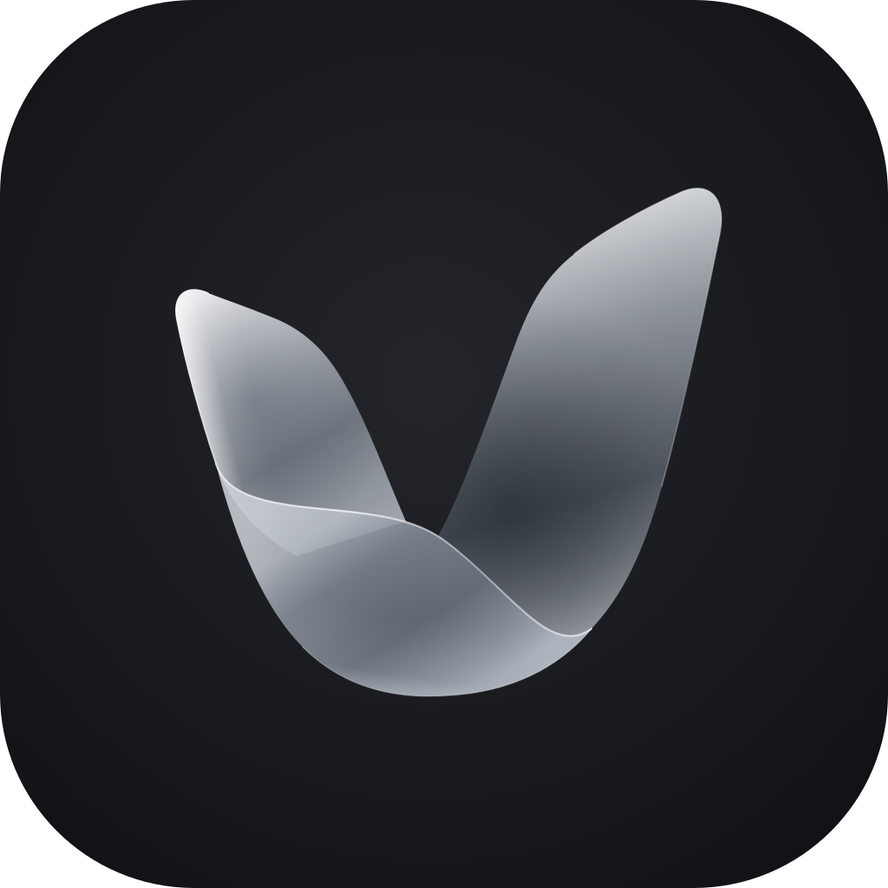
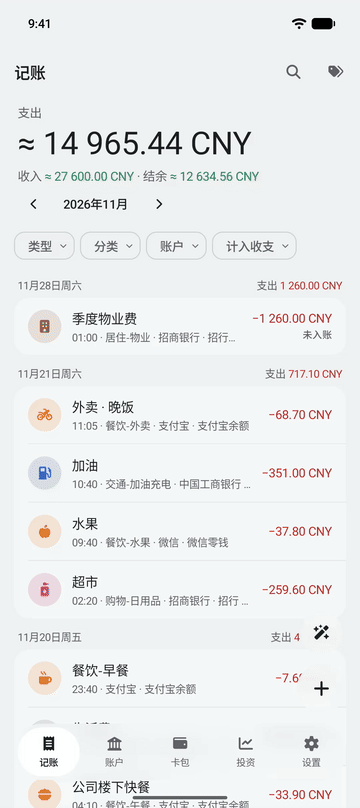
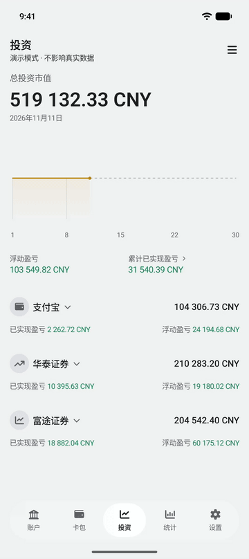
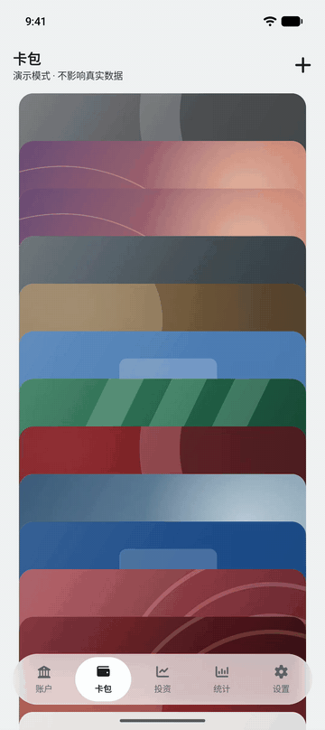

<p align="center">
  
</p>

<h1 align="center">Valnook</h1>

<p align="center">一款记录只存在你手机上的 Android 个人财务应用。</p>

<p align="center">
  <a href="https://github.com/LuoIsHere/Valnook/releases"></a>
  <a href="../LICENSE"></a>
  
  <a href="https://github.com/LuoIsHere/Valnook/actions/workflows/ci.yml"></a>
</p>

<p align="center"><a href="../README.md">English</a> · 简体中文</p>

Valnook 帮你记下自己有什么、欠什么、钱花在了哪里：银行账户、信用卡、定期存款、投资和日常账单都能记，币种不限。不用注册，开发者也不运营任何服务器。记录只保存在手机上，只有你打开 OneDrive 备份、自动汇率或 AI 记账时，应用才会联网。

## 主要功能

<table>
  <tr><th>AI 记账</th><th>投资</th><th>卡包</th></tr>
  <tr>
    <td></td>
    <td></td>
    <td></td>
  </tr>
</table>

**记账**
- 记支出、收入和转账。内置 88 个分类，可以改名、隐藏、调整顺序，也可以自己添加。
- 每笔账都能填优惠和备注，最多附 4 张图片；不属于任何账户的开销也能记。
- 外币账单按当天汇率折算，也可以单独给这一笔填汇率。转账支持跨币种，也能记手续费。
- 支出可以全额或分几次退款，也可以标成待报销，在「报销」页看还有多少钱没回来。
- 快速记账：可以设置成一打开应用就进入记账；在其他应用里分享文字或图片就能记一笔；长按桌面图标也有快捷入口。

**AI 记账**（可选，默认关闭）
- 用你自己的 AI 服务：连接任意兼容 OpenAI 接口的服务，填上你自己的 API Key。Valnook 不提供、也不中转 AI 服务。应用里的快速入门以 DeepSeek 为例，一步步说明怎么填。
- 说一句“昨天打车 32”、分享一段消息或发一张截图，AI 就会生成账单草稿。草稿要你确认后才会保存，保存之后也还能修改或撤销。
- 也可以直接提问，比如“上个月吃饭花了多少”。AI 会在手机上查询，并告诉你它查了哪些内容。
- 请求从手机直接发到你选的服务。API Key 在手机上加密保存，余额和账号不会发出去。具体发送哪些内容，见 [隐私政策](PRIVACY_POLICY_CN.md#5-ai-功能)。

**账户与资金**
- 每个主账户（比如一家银行或一家券商）下面可以有多个币种的储蓄和信用子账户。主账户可以分组，暂时不看的分组可以收起来。
- 账户页能看到近三个月的净资产走势，余额变动按天分组，每一笔后面都附上变动后的余额。
- 信用卡可以记录额度、账单日和还款日，还能按账单周期查看：本期花了多少、上期账单多少、还剩多少要还。

**投资**
- 记录买入、卖出（含手续费）和派息，平均成本、已实现和浮动盈亏、每笔持仓的市值都会自动算好。
- 每个标的有一个汇总页，跨所有账户显示现价、各账户持仓、按月的交易记录和价格走势。
- 标的可以按资产类型归类，已实现盈亏可以按标的拆开看。价格需要手动填写。

**定期存款**
- 记下本金、期限和利率，可以直接从子账户扣款开立，到期后结清。

**汇率**
- 所有合计都换算成你选的主币种。汇率可以手动填，也可以打开自动获取，从 [Frankfurter](https://frankfurter.dev) 每天更新一次。
- 统计按每一天当日的汇率估值。没有汇率的币种不会按 1:1 硬算，而是不计入合计，并标注出来。

**统计**
- 净资产、可用现金和投资市值的日、月走势，以及资产按账户、资产类型和币种的分布。
- 按月看支出和收入：分类环形图、每日柱状图，点进分类还能看到具体账单。

**卡包**
- 卡片叠成一摞，可以用内置卡面，也可以用自己的图片，卡面统一存在卡面库里。
- 卡片绑定子账户后，可以直接看到它的余额和收支。
- 卡背信息（如卡号、CVV）在手机上加密保存。

**网页端管理**
- 扫二维码或输入六位配对码，就能让同一局域网内的电脑浏览器连上手机，在电脑上管理账户、记录和投资，也能查看账单和收支统计。

**备份与导出**
- 可以生成本地备份文件、手动或定时备份到 OneDrive，也可以导出 Excel。只要存储位置支持，每份备份写完都会读回来校验一遍。
- 账单图片会备份到 OneDrive，需要时再下载回来。已经传到 OneDrive 的图片，可以手动或自动从手机上清掉。

**界面**
- 支持简体中文和英文，浅色和深色主题默认跟随系统。还有演示模式，可以先用示例数据熟悉一下。

## 设计原则

- **本地优先。** 记录都存在手机上。没有 Valnook 账号，也没有 Valnook 服务器。
- **联网由你决定。** 只有 OneDrive 备份、自动汇率和 AI 记账会联网，而且默认都是关闭的。网页端管理只在局域网内使用。
- **卡片信息不出手机。** 卡背信息用 Android Keystore 管理的密钥加密，不会进入备份和导出文件，网页端也看不到。
- **数据随时带走。** 完整备份是独立的文件，[格式公开](DATABASE.md)；所有数据也都能导出成 Excel。
- **没有广告，没有追踪。** Valnook 不含任何广告或统计分析库，你的记录也不会被拿去做广告。

## 系统要求

- Android 13 或更高版本。

## 安装

1. 在 [Releases 页面](https://github.com/LuoIsHere/Valnook/releases) 下载最新的 APK。
2. 在手机上打开它。如果系统提示，请允许浏览器或文件管理器安装未知应用。
3. 打开 Valnook，按引导完成设置。

**升级：** 直接用新的 APK 覆盖安装，记录会保留。注意，新版本做的备份无法在旧版本里恢复。

## 快速上手

1. 选择语言，同意隐私政策。
2. 选择主币种。自动汇率可以现在打开，也可以以后在「设置」里打开。
3. 在「账户」页点 **+**，添加主账户和它的子账户，填好币种和期初余额。
4. 在主要页面点 **+** 记账；余额变动、交易和定期存款也随时记下来。想用聊天的方式记账，到 **设置 › AI** 里设置。
5. 想先看看效果？打开 **设置 › 演示模式**。演示数据是临时的，和你自己的记录互不影响。

## 使用须知

- 投资价格需要手动填写。汇率默认也是手动填写；打开自动获取后，汇率由第三方提供，仅供参考。会发送哪些数据，见 [隐私政策](PRIVACY_POLICY_CN.md#4-自动获取汇率)。
- AI 生成的草稿可能有错，确认前请逐条看一遍。使用 AI 功能时，你输入或分享的内容会发给你配置的服务，适用该服务自己的条款和收费。
- 云端备份目前只支持 OneDrive。Google Drive 备份 [已停用](GOOGLE_DRIVE_BACKUP.md)。
- 备份文件和 Excel 导出文件都没有加密，请放在安全的地方。本地备份不含账单图片，图片只会备份到 OneDrive。
- 卡背信息不会备份。恢复备份后会被清空，卸载应用或换手机后也找不回来。
- 网页端管理使用未加密的连接，请只在可信的网络和设备上使用。
- Valnook 是记录和计算工具，不构成投资建议。重要的数字请自己再核对一遍。

## 从源码构建

需要 Android Studio、JDK 17 或更高版本，以及 Android SDK Platform 37。用 Android Studio 自带的 JDK 就可以。

```bash
./gradlew :app:assembleDebug
```

```bash
./gradlew quickCheck
```

`quickCheck` 会编译所有模块、运行全部单元测试、编译设备测试代码，并检查网页端脚本。CI 每次推送运行的也是这条命令。

应用用 Kotlin、Jetpack Compose 和 Material 3 编写，Room 存储数据，Hilt 负责依赖注入，Navigation 3 负责页面导航。网页端管理是由应用内的 Ktor 服务器提供的 HTML、CSS 和 JavaScript。OneDrive 登录和项目的签名密钥绑定，用其他密钥签名的版本无法登录 OneDrive。

<details>
<summary>模块</summary>

| 模块 | 内容 |
| --- | --- |
| `app` | 启动、导航、依赖装配和数据会话。 |
| `core:domain` | 数据模型、财务规则和仓库接口。 |
| `core:data` | 存储、仓库、汇率、备份与恢复，以及网页服务器。 |
| `core:designsystem` | 共用的主题、图标和界面组件。 |
| `feature:*` | 账户、资金、定期、投资、记账、AI、卡包、统计、设置、备份和网页端管理页面。 |

</details>

## 文档

- [CHANGELOG.md](../CHANGELOG.md)：各版本的主要变化。
- [docs/CHANGELOG.md](CHANGELOG.md)：各版本的完整变更列表。
- [docs/DATABASE.md](DATABASE.md)：数据库结构和备份格式。
- [docs/ONEDRIVE_BACKUP.md](ONEDRIVE_BACKUP.md)：OneDrive 备份的工作方式。
- [docs/PRIVACY_POLICY_CN.md](PRIVACY_POLICY_CN.md)：隐私政策与免责声明。
- [LICENSE](../LICENSE)：MIT 许可证。
- [THIRD_PARTY_NOTICES](../THIRD_PARTY_NOTICES)：Valnook 用到的第三方软件和图标，以及它们的许可证。

## 许可与免责声明

Copyright © 2026 LuoIsHere

Valnook 的源代码以 [MIT 许可证](../LICENSE) 开源。这份许可证不包括 Valnook 的名称和标志：欢迎分支和修改版使用代码，但请换用自己的名称和标志，不要以官方应用的名义发布。

Valnook 按「原样」提供，**不附带任何形式的担保**。在适用法律允许的最大范围内，作者和版权持有人不对因使用或无法使用本软件造成的任何财务损失承担责任。详见 [隐私政策与免责声明](PRIVACY_POLICY_CN.md)。

## 致谢与商标

Valnook 基于 [Jetpack Compose](https://developer.android.com/compose)、[Room](https://developer.android.com/training/data-storage/room)、[Hilt](https://dagger.dev/hilt/)、[Ktor](https://ktor.io)、[Microsoft Authentication Library](https://github.com/AzureAD/microsoft-authentication-library-for-android) 和 [ZXing](https://github.com/zxing/zxing) 构建。图标来自 [Font Awesome Free](https://fontawesome.com)，按 CC BY 4.0 许可使用；自动获取的汇率来自 [Frankfurter](https://frankfurter.dev)。完整信息和许可证见 [THIRD_PARTY_NOTICES](../THIRD_PARTY_NOTICES)。

Android 是 Google LLC 的商标，Microsoft 和 OneDrive 是 Microsoft Corporation 的商标，DeepSeek 和 OpenAI 分别是其所有者的商标。DeepSeek 只在 AI 设置指南里作为示例出现，不代表推荐。Valnook 是独立项目，与 Google、Microsoft、Frankfurter、DeepSeek 和 OpenAI 均无关联，也未获得它们的认可。

## 作者的话

我平时做嵌入式开发，Valnook 是我写的第一个 Android 应用。起因很简单：用过不少记账软件，总有些地方觉得别扭，而卡包、投资汇总、云备份这些我最想要的功能，往往还要付费。所以我自己做了一个，并且把它开源。记录自己的钱这件事，不该被锁在付费墙后面，也不该只能去相信一个看不见里面的软件。

这个项目是在 Codex 和 Claude Code 的辅助下完成的，大部分代码由 AI 编写，架构、实现方式和取舍由我决定。我自己每天都在用它。现在还是早期版本，粗糙的地方肯定不少，用着不顺手或者发现问题，欢迎[提 issue](https://github.com/LuoIsHere/Valnook/issues)。
