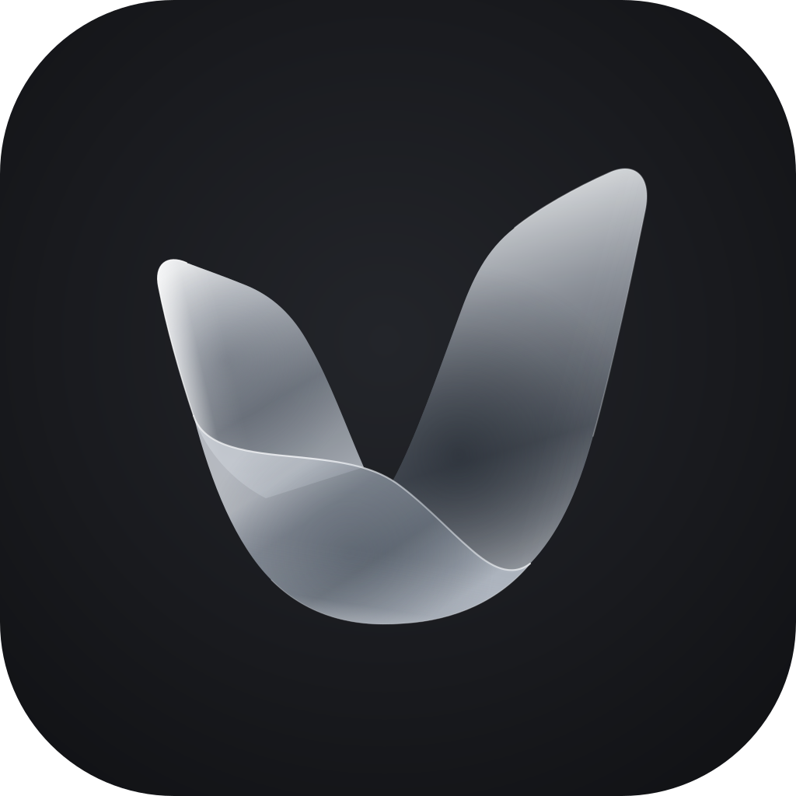
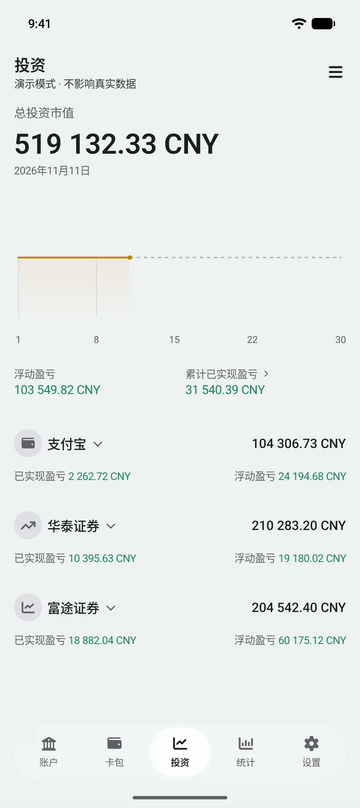

<p align="center">
  
</p>

<h1 align="center">Valnook</h1>

<p align="center">一款把记录保存在手机本地的 Android 个人财务应用。</p>

<p align="center">
  <a href="https://github.com/LuoIsHere/Valnook/releases"></a>
  <a href="../LICENSE"></a>
  
</p>

<p align="center"><a href="../README.md">English</a> · 简体中文</p>

Valnook 用来记录你的资产和负债：银行账户、信用卡、定期存款和投资，支持任意多种货币。使用前无需注册，开发者也不运营任何服务器。记录保存在手机本地，只有在你开启 OneDrive 备份或自动获取汇率时，应用才会联网。

## 主要功能

<table>
  <tr><th>账户</th><th>投资</th><th>卡包</th></tr>
  <tr>
    <td></td>
    <td></td>
    <td></td>
  </tr>
</table>

**账户与资金**
- 每个主账户（如一家银行或券商）下可设置多个币种的储蓄和信用子账户。主账户可以分组，分组可折叠。
- 账户页显示近三个月的净资产走势；余额变动按天分组，并列出每次变动后的余额。
- 信用子账户可记录信用额度、账单日和还款日。

**投资**
- 记录买入、卖出（含手续费）和派息，自动计算平均成本、已实现和浮动盈亏，以及每笔持仓的市值。
- 每个标的有一个汇总所有账户的页面：现价、各账户持仓、按月的交易记录和价格走势。
- 标的可按资产类型归类，可按标的查看已实现盈亏。价格需手动填写。

**定期存款**
- 记录本金、期限和利率，可选择从子账户扣款开立，到期后结清。

**汇率**
- 合计金额按你选择的主币种换算。汇率可以手动填写，也可以开启自动获取（来自 [Frankfurter](https://frankfurter.dev)，每天更新一次）。
- 统计按每一天当日的汇率估值。没有汇率的币种不计入合计并会标注，不再按 1:1 计算。

**统计**
- 净资产、可用现金和投资市值的日、月走势。

**卡包**
- 卡片以堆叠方式排列，可使用内置卡面或自己的图片，卡面保存在卡面库中。
- 绑定子账户的卡片会显示该子账户的余额和收支。
- 卡背信息（如卡号和 CVV）在手机上加密保存。

**网页端管理**
- 用二维码或六位配对码，与同一局域网内的电脑浏览器配对，在电脑上管理账户、记录和投资。

**备份与导出**
- 创建本地备份文件，手动或定时备份到 OneDrive，导出 Excel。在存储位置允许的情况下，每份备份写入后都会回读校验。

**界面**
- 支持英文和简体中文；支持浅色和深色主题，默认跟随系统。演示模式提供示例数据，方便先熟悉功能。

## 设计原则

- **本地优先。** 记录保存在手机上。没有 Valnook 账号，开发者也不运营服务器。
- **联网由你决定。** 只有 OneDrive 备份和自动获取汇率会连接互联网，两者都要你手动开启。网页端管理只在局域网内使用。
- **卡片信息不离开手机。** 卡背信息使用 Android Keystore 管理的密钥加密，不会进入备份、导出文件或网页端管理。
- **数据可以带走。** 完整备份是独立的文件，[格式公开](DATABASE.md)，所有数据也可以导出为 Excel。
- **没有广告，没有追踪。** Valnook 不包含任何广告或分析统计库，你的记录也不会被用于广告。

## 系统要求

- Android 13 或更高版本。

## 安装

1. 在 [Releases 页面](https://github.com/LuoIsHere/Valnook/releases) 下载最新的 APK。
2. 在手机上打开它。如果系统提示，请允许浏览器或文件管理器安装未知应用。
3. 打开 Valnook，按引导完成设置。

**升级：** 直接用新的 APK 覆盖安装即可，记录会保留。新版本创建的备份无法在旧版本中恢复。

## 快速上手

1. 选择语言，并同意隐私政策。
2. 选择主币种。可以在这里开启自动获取汇率，也可以之后在「设置」中开启。
3. 在「账户」页点 **+** 新增主账户，同时添加子账户，并填写币种和期初余额。
4. 按实际情况记录余额变动、交易和定期存款。
5. 想先看看效果，可以打开 **设置 › 演示模式**。演示数据是临时的，与你的记录相互独立。

## 使用须知

- 投资价格需要手动填写。汇率默认手动填写；开启自动获取后，汇率由第三方提供，仅供参考。发送哪些数据请见 [隐私政策](PRIVACY_POLICY_CN.md#4-自动获取汇率)。
- 云端备份目前只支持 OneDrive。Google Drive 备份 [已停用](GOOGLE_DRIVE_BACKUP.md)。
- 备份文件和 Excel 导出文件都没有加密，请妥善保存。
- 卡背信息永远不会备份。恢复备份后会被清除，卸载应用或更换设备后也无法找回。
- 网页端管理使用未加密的连接，请只在可信的网络和设备上使用。
- Valnook 是记录和计算工具，不构成投资建议。重要数字请自行核对。

## 从源码构建

环境要求：Android Studio，JDK 17 或更高版本，Android SDK Platform 37。Android Studio 自带的 JDK 即可。

```bash
./gradlew :app:assembleDebug
```

```bash
./gradlew testDebugUnitTest
```

应用使用 Kotlin、Jetpack Compose 和 Material 3 编写，Room 存储数据，Hilt 负责依赖注入，Navigation 3 负责页面导航。网页端管理是由应用内 Ktor 服务器提供的 HTML、CSS 和 JavaScript。OneDrive 登录与项目的签名密钥绑定，使用其他密钥签名的构建无法登录 OneDrive。

<details>
<summary>模块</summary>

| 模块 | 内容 |
| --- | --- |
| `app` | 启动、导航、依赖装配和数据会话。 |
| `core:domain` | 数据模型、财务规则和仓库接口。 |
| `core:data` | 存储、仓库、汇率、备份与恢复，以及网页服务器。 |
| `core:designsystem` | 共用的主题、图标和界面组件。 |
| `feature:*` | 账户、资金、定期、投资、卡包、统计、设置、备份和网页端管理页面。 |

</details>

## 文档

- [CHANGELOG.md](../CHANGELOG.md)：各版本的主要变化。
- [docs/CHANGELOG.md](CHANGELOG.md)：各版本的完整变更列表。
- [docs/DATABASE.md](DATABASE.md)：数据库结构和备份格式。
- [docs/ONEDRIVE_BACKUP.md](ONEDRIVE_BACKUP.md)：OneDrive 备份的工作方式。
- [docs/PRIVACY_POLICY_CN.md](PRIVACY_POLICY_CN.md)：隐私政策与免责声明。
- [LICENSE](../LICENSE)：MIT 许可证。
- [THIRD_PARTY_NOTICES](../THIRD_PARTY_NOTICES)：Valnook 包含的第三方软件和图标，以及它们的许可证。

## 许可与免责声明

Copyright © 2026 LuoIsHere

Valnook 按 [MIT 许可证](../LICENSE) 发布，按「原样」提供，**不附带任何形式的担保**。在适用法律允许的最大范围内，作者和版权持有人不对因使用或无法使用本软件造成的任何财务损失承担责任。详见 [隐私政策与免责声明](PRIVACY_POLICY_CN.md)。

## 致谢与商标

Valnook 基于 [Jetpack Compose](https://developer.android.com/compose)、[Room](https://developer.android.com/training/data-storage/room)、[Hilt](https://dagger.dev/hilt/)、[Ktor](https://ktor.io)、[Microsoft Authentication Library](https://github.com/AzureAD/microsoft-authentication-library-for-android) 和 [ZXing](https://github.com/zxing/zxing) 构建。图标来自 [Font Awesome Free](https://fontawesome.com)，按 CC BY 4.0 许可使用；自动获取的汇率来自 [Frankfurter](https://frankfurter.dev)。完整信息和许可证见 [THIRD_PARTY_NOTICES](../THIRD_PARTY_NOTICES)。

Android 是 Google LLC 的商标。Microsoft 和 OneDrive 是 Microsoft Corporation 的商标。Valnook 是独立项目，与 Google、Microsoft 和 Frankfurter 均无关联，也未获得其认可。

## 作者的话

我平时做嵌入式开发，Valnook 是我写的第一个 Android 应用。起因很简单：用过不少记账软件，总有些地方觉得别扭，而卡包、投资汇总、云备份这些我最想要的功能，往往还要付费。所以我自己做了一个，并且把它开源。记录自己的钱这件事，不该被锁在付费墙后面，也不该只能去相信一个看不见里面的软件。

这个项目是在 Codex 和 Claude Code 的辅助下完成的，大部分代码由 AI 编写，架构、实现方式和取舍由我决定。我自己每天都在用它。现在还是早期版本，粗糙的地方肯定不少，用着不顺手或者发现问题，欢迎[提 issue](https://github.com/LuoIsHere/Valnook/issues)。
