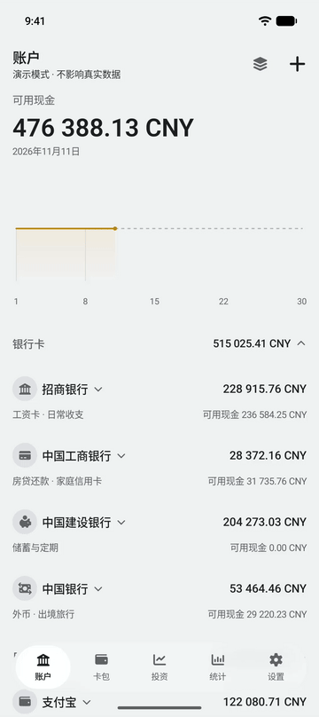
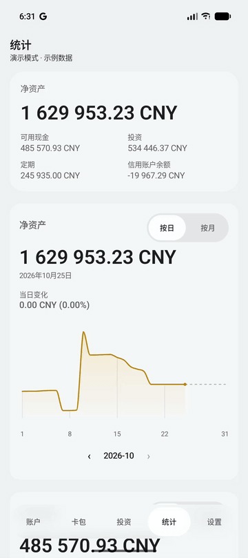
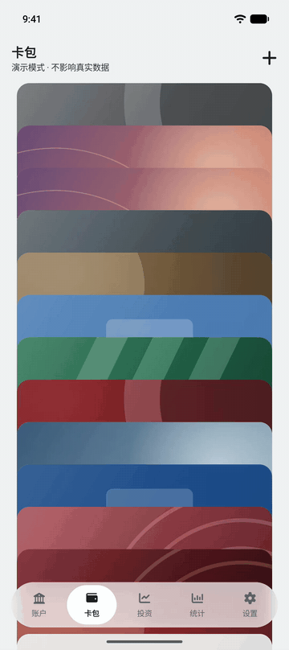

  

<h1 align="center">Valnook</h1>

一款将数据保存在手机本地的 Android 个人财务记录应用。

<strong>版本 0.0.17</strong> · <a href="../LICENSE">MIT 许可证</a>

<a href="../README.md">English</a> · 简体中文

Valnook 用于记录个人资产和负债，包括银行账户、信用卡、定期存款和投资，支持多种货币。应用无需注册，也不依赖服务器，数据保存在手机本地，可选择备份到 OneDrive。

## 主要功能

- **账户。** 每个主账户（如一家银行或券商）下可设置多个币种的储蓄和信用子账户。可记录余额变动，查看近三个月的余额走势，并跟踪信用额度和账单日。主账户可以分组，分组可折叠。
- **定期存款。** 记录本金、期限和利率，到期后结清。
- **投资。** 记录持仓和交易，显示平均成本、已实现和未实现盈亏，以及每月市值走势。价格需手动填写。
- **统计。** 查看净资产、可用现金和投资市值的日、月走势。
- **卡包。** 卡片以堆叠方式排列，可使用内置卡面或导入图片，卡面保存在卡面库中。绑定子账户后，卡片会显示该账户的余额和当月收支。卡背信息（如卡号和 CVV）加密保存，仅存于本机。
- **网页管理。** 与同一局域网内的电脑浏览器配对后，可在电脑上管理账户和记录。
- **备份与导出。** 支持本地备份文件、手动或定时备份到 OneDrive，以及导出 Excel。

应用支持中文和英文、浅色和深色主题，并提供含示例数据的演示模式。

<table>
  <tr><th>账户</th><th>统计</th><th>卡包</th></tr>
  <tr>
    <td></td>
    <td></td>
    <td></td>
  </tr>
</table>

## 下载

最新版本可在 [Releases](https://github.com/LuoIsHere/Valnook/releases) 页面下载。需要 Android 16 或更高版本。

## 使用前请了解

- 投资价格和汇率需手动填写，应用不会从网络获取。
- 云备份仅支持 OneDrive，Google Drive 备份[已停用](GOOGLE_DRIVE_BACKUP.md)。
- 备份文件和导出的 Excel 不加密，请妥善保管。
- 卡背信息不会进入备份。恢复备份后卡背为空，卸载应用或更换设备后无法找回。
- 网页管理与手机之间的连接不加密，请仅在可信的网络和设备上使用。
- Valnook 提供记录和计算工具，不构成投资建议。重要数据请自行核对。

详见[隐私政策](PRIVACY_POLICY_CN.md)。

## 开发说明

应用使用 Kotlin、Jetpack Compose 和 Material 3 编写。Room 负责存储，Hilt 负责依赖注入，Navigation 3 负责导航。网页管理由随应用打包的 HTML、CSS 和 JavaScript 组成，通过应用内的 Ktor 服务提供。卡背信息使用 AES-GCM 加密，密钥由 Android Keystore 管理。

debug 版本无需额外配置，可直接通过 `./gradlew :app:assembleDebug` 构建。OneDrive 登录与项目的签名密钥绑定，使用其他密钥签名的版本无法登录。

- [OneDrive 备份的工作原理](ONEDRIVE_BACKUP.md)
- [数据库结构说明](DATABASE.md)
- [完整更新日志](CHANGELOG.md)

模块

| 模块 | 内容 |
| --- | --- |
| `app` | 应用启动、导航、依赖装配和数据会话。 |
| `core:domain` | 数据模型、财务计算规则和数据访问接口。 |
| `core:data` | 存储、数据访问实现、备份恢复和网页服务。 |
| `core:designsystem` | 共用主题和 UI 组件。 |
| `feature:*` | 账户、资金、定期、投资、卡包、统计、设置、备份和网页管理页面。 |

## 免责声明

Valnook 依据 [MIT 许可证](../LICENSE)提供，不附带任何担保。在适用法律允许的最大范围内，作者及版权持有人不对因使用或无法使用本软件而产生的财务损失承担责任。详见[隐私政策与免责声明](PRIVACY_POLICY_CN.md)。

## 写在最后

我平时做嵌入式开发，Valnook 是我写的第一个 Android 应用。起因很简单：用过不少记账软件，总有些地方觉得别扭，而卡包、投资汇总、云备份这些我最想要的功能，往往还要付费。所以我自己做了一个，并且把它开源。记录自己的钱这件事，不该被锁在付费墙后面，也不该只能去相信一个看不见里面的软件。

这个项目是在 Codex 和 Claude Code 的辅助下完成的，大部分代码由 AI 编写，架构、实现方式和取舍由我决定。我自己每天都在用它。现在还是早期版本，粗糙的地方肯定不少，用着不顺手或者发现问题，欢迎[提 issue](https://github.com/LuoIsHere/Valnook/issues)。
